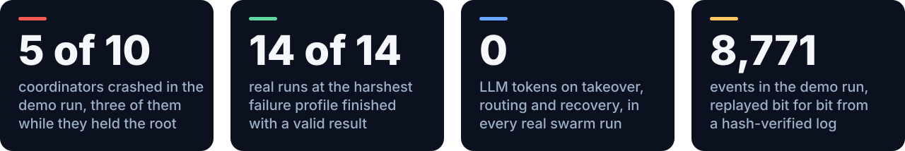
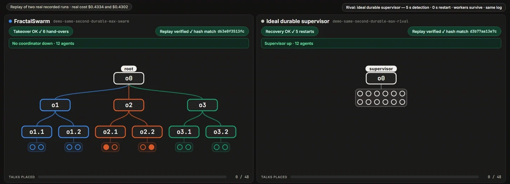

<p align="center">
  <a href="#verify-it-yourself">
    <picture>
      <source media="(prefers-reduced-motion: reduce) and (max-width: 640px)" srcset="docs/assets/hero-phone-still.svg">
    <source media="(prefers-reduced-motion: reduce)" srcset="docs/assets/hero-still.svg">
    <source media="(max-width: 640px)" srcset="docs/assets/hero-phone.svg">
      
    </picture>
  </a>
</p>

<p align="center">
  <a href="https://github.com/Yoelcanarion/fractalswarm/actions/workflows/replay.yml"></a>
  <a href="#why-metas-models-matter"></a>
  
  <a href="LICENSE"></a>
</p>

<p align="center">
  <a href="#verify-it-yourself"><b>Verify it yourself</b></a> ·
  <a href="#the-idea-shared-log-not-shared-brain">How it works</a> ·
  <a href="#why-metas-models-matter">Meta's models</a> ·
  <a href="#the-evidence">The evidence</a> ·
  <a href="bench/REPORT.md">The report</a>
</p>

FractalSwarm is a runtime for teams of LLM agents. Its coordinators, which plan, assign and check the work, form a tree. Any of them can die mid-run, the root included, and the survivors take over the work with no election. Zero LLM tokens spent on coordination. Every run this repository ships replays bit for bit from a hash-verified log.

The demo plans a conference from messy emails: twelve agents place 48 talks while five of the ten coordinators crash. The crashes are injected, inside one Python process, and [not every set of deaths recovers](#limitations).

Built on Muse Spark, Muse Wonder and Llama PromptGuard 2 for the Meta Global AI Developer Hackathon.

<p align="center">
  <picture>
    <source media="(max-width: 640px)" srcset="docs/assets/tiles-phone.svg">
    
  </picture>
</p>

Clone it and run one command. [uv](https://docs.astral.sh/uv/) installs the rest, Python included, and no API key is needed.

```sh
uv run fractalswarm demo --verify
```

<p align="center">
  <picture>
    <source media="(prefers-reduced-motion: reduce) and (max-width: 640px)" srcset="docs/assets/arena-same-second-phone.png">
    <source media="(prefers-reduced-motion: reduce)" srcset="docs/assets/arena-same-second.png">
    <source media="(max-width: 640px)" srcset="docs/assets/arena-same-second-phone.webp">
    
  </picture>
</p>

<p align="center">Two real runs, sped up. Each side takes five crashes at the same second, set by hand, not by the benchmark's rule. One pair is one run on one seed: over ten seeds the two tied on stall time and extra cost.</p>

On the real model, with five of its ten coordinators crashed and half its agents killed, every run finished with a valid result. It stalled 11.2 s against 42.8 s for an in-process supervisor, and tied an ideal durable supervisor on stall time and extra cost. [The conditions, and where it does worse](#the-evidence).

## The problem

A team of LLM agents often depends on one coordinator: it plans, assigns and checks the work. When it crashes, the team waits, or does the work again.

In the simplest setup the workers run inside the coordinator's process and die with it, so their calls are paid for twice. A durable supervisor fixes that: its workers survive and a standby takes over. But then you run a supervisor, a standby and something to watch them.

**Can a team recover without a supervisor?**

## The idea: shared log, not shared brain

Ten small coordinators form a tree: one root, three tracks, six sessions, leading twelve agents. All of them read and write one hash-chained event log. This is the first takeover of the recorded run, the moment the root dies:

<p align="center">
  <picture>
    <source media="(prefers-reduced-motion: reduce) and (max-width: 640px)" srcset="docs/assets/takeover-phone-still.svg">
    <source media="(prefers-reduced-motion: reduce)" srcset="docs/assets/takeover-still.svg">
    <source media="(max-width: 640px)" srcset="docs/assets/takeover-phone.svg">
    
  </picture>
</p>

When a coordinator stops sending heartbeats:

1. **Every survivor sees the same thing.** Membership lives in the log, so all of them agree on who is dead.
2. **Every survivor computes the same heir.** For each piece of work, the heir is the live member with the highest `hash(goal, member)`, a rule known as highest random weight (HRW).
3. **The heir adopts the work,** and every result already in the log. The dead coordinator's children re-attach to it.
4. **The root is not special.** When the root dies, its duties move by the same rule.

No separate recovery mechanism: every survivor computes the same heir from the log with one rule (HRW), so there is no election. Takeover makes no LLM call.

The log is still a central component. We remove the coordinator as a single point of decision, not every single point of failure.

## Why Meta's models matter

The hard part of the demo task, planning a conference from messy emails, is reading people.

| Model | What it does here |
|---|---|
| **Muse Spark** | Turns human language into constraints, each linked to its source sentence. It reads the emails, places the talks, checks the work and writes the blurbs. |
| **Muse Wonder** | Writes the root plan. Arbitration between agents is built and tested on the fake model; the real runs we checked had no dispute to settle. |
| **Llama PromptGuard 2** | Runs locally and screens each email and pasted input before an agent reads it. It screened all 32 inputs of every recorded demo run and arena pair. The bench's runs, runs on the fake LLM and an install without it use a pattern scanner instead. |

Every Muse token goes to the problem. "Zero LLM tokens spent on coordination" is a property of the design, measured in every real run of the swarm: takeover, routing and recovery are code. Planning and judging do call the model, and they count as work ([`bench/REPORT.md`](bench/REPORT.md) §2). The rivals we built spend none either, because their supervisors are code too; the LangGraph baseline does, because that pattern routes through the model (about 3% of its tokens).

## The evidence

We built the strongest rival we could implement fairly, and ran the headline under the same failures on the real model; the sweeps around it ran at $0 on the fake model, and the list below says which is which. The rules, the rival's assumptions and every comparison are in [`bench/REPORT.md`](bench/REPORT.md); the hypotheses were committed in [`bench/PREREG.md`](bench/PREREG.md) before any run against that rival. Every claim here maps to its runs in [`docs/claims.md`](docs/claims.md).

**The outcomes were written down before any run against that rival. We got outcome B:** "Resilience comparable to an ideal durable supervisor, without a central coordinator or a separate recovery mechanism."

**The setting.** T2 is the conference task. C0 is a run with no failures. C3, the harshest failure profile, is five coordinator crashes, half the agents killed, 20% API faults, 20% message loss and a network partition. A kill is an injected actor crash inside one Python process, and a seed is one repeat of a run. The ideal durable supervisor is one coordinator whose agents keep working through a crash; it is back after 5 s and loses nothing. The 14 real runs at C3 are the ten of the headline and four earlier ones.

<p align="center">
  <picture>
    <source media="(max-width: 640px)" srcset="docs/assets/scoreboard-phone.svg">
    
  </picture>
</p>

<p align="center">
  <picture>
    <source media="(max-width: 640px)" srcset="docs/assets/evidence-phone.svg">
    
  </picture>
</p>

**Where the swarm stands, rival by rival:**

-  **An ideal durable supervisor,** whose agents keep working through a crash: preserved work, extra cost, time to recover, duplicated spend and stall time. *Real model, T2, 10 seeds.*
-  **The same rival, on false deaths:** 1.90 per run against none. The swarm's failure detector declares live coordinators dead. *Real model, T2, 10 seeds.*
-  **A realistic durable supervisor,** which redoes its in-flight calls: coordinator-dependency time 11.4 s against 50.3 s. Stall time and extra cost tie, and false deaths are a loss. *Real model, T2 at C3, 10 seeds, per crash.*
-  **An external supervisor that detects and restarts within 0.5–1 s,** while the swarm keeps its 5 s detection: locality fails, at 13.2 and 5.7 times the supervisor's dependency time. *Fake model, T2 at C3.*
-  **The ideal durable supervisor, with each coordinator process failing at the same rate:** the supervisor recovers sooner. *Fake model, T2, single-crash probes, 4 seeds.*
-  **An in-process supervisor,** whose workers die with it: stalled 11.2 s against 42.8 s, with +2.4% extra cost against +67.0% on the pre-registered basis, or −1.1% against +29.2% on completed calls only. Most of that gap comes from the rival's design, so it is no evidence against a well-built supervisor. *Real model, T2 at C3, 10 seeds.*

**What we do not claim:** "simpler", "cheaper" or "more reliable". Having no supervisor is not, by itself, evidence for any of them.

<details>
<summary><b>Every claim with its setting</b></summary>

<br>

- **Against the ideal durable supervisor (`durable-max`):** a tie on preserved work, extra cost, time to recover, duplicated spend and stall time, and a loss on false deaths (1.90 per run against none), over ten seeds. All 80 runs completed and 79 are valid (T2, C0 and C3, seeds 1–10, recorded after the handler freeze); the exception is the swarm at C0 on seed 5, one wrong model reading with no crash.
- **Locality:** On the real model, at the headline point (T2, C3: five coordinator crashes, half the agents killed), locality against the ideal durable supervisor tied over ten seeds: the swarm's coordinator-dependency time, blast radius and idle agent-seconds were 0.57, 0.43 and 0.70 of its values, and at or below half on 4, 7 and 6 of the ten seeds. At the $0 gate, on the fake model, locality tied at C2 and C3 too.
- **Against a realistic durable supervisor (`durable`):** Per crash, on the real model, at the headline point (T2, C3: five coordinator crashes, half the agents killed), against a realistic durable supervisor, which loses its own in-flight plan and judge calls and redoes them after the restart, the swarm's coordinator-dependency time was 11.4 s against 50.3 s and a crash held up 9.0% of the sessions against 37.3%, at or below half on each of the ten seeds. Per process the two are comparable. Stall time and extra cost tie, and false deaths are a loss, as against the ideal one.
- **Where it does not:** against an external supervisor that detects and restarts within 0.5–1 s while the swarm keeps its 5 s detection, locality fails, at 13.2 and 5.7 times the supervisor's dependency time. Per process, with each coordinator process failing at the same rate, the two are comparable, and the supervisor recovers sooner. The swarm's failure detector also produces false deaths; the supervisors have none.
- **Against an in-process supervisor (`central`), whose workers die with it,** the swarm at C3 stalled 11.2 s against 42.8 s, with +2.4% extra cost against +67.0% on the pre-registered basis (which estimates the cost of cancelled calls), or −1.1% against +29.2% on completed calls only (real model, T2, 10 seeds). Most of that gap comes from the rival's design, so it is no evidence against a well-built supervisor.
- **Also on the real model, two seeds each, descriptive only:** LangGraph's hierarchical-teams pattern (`bench/REPORT.md` §4.10.8) and a scaling sweep from 1 to 16 agents (§8).

</details>

## Verify it yourself

Replay proves that this code produces the recorded run from the recorded model outputs. It does not prove where those outputs came from.

<p align="center">
  <picture>
    <source media="(prefers-reduced-motion: reduce) and (max-width: 640px)" srcset="docs/assets/terminal-phone-still.svg">
    <source media="(prefers-reduced-motion: reduce)" srcset="docs/assets/terminal-still.svg">
    <source media="(max-width: 640px)" srcset="docs/assets/terminal-phone.svg">
    
  </picture>
</p>

GitHub's machines replay every shipped run on each push to `master`: see the [Replay workflow](https://github.com/Yoelcanarion/fractalswarm/actions/workflows/replay.yml). On your own machine:

```sh
# replays a real recorded run, opens the UI
uv run fractalswarm demo --verify

# MATCH or MISMATCH, with the head hash
uv run fractalswarm replay demo/final --verify

# recomputes every heir from the log
uv run fractalswarm takeover demo/final
```

Then change one letter, and see it caught:

```sh
cp -r demo/final tampered
sed -i.bak '6593s/room-d/room-c/' tampered/events.jsonl

# MISMATCH, first divergence at seq 6593
uv run fractalswarm replay tampered --verify
```

The numbers need no model and no key either. These commands only print:

```sh
# outcome B, by the rules of bench/PREREG.md
uv run fractalswarm bench verdicts bench/results/rivals-gate bench/results/sweeps

# the ten seeds, seed by seed; the outcome reads pending here, the gate decides it
uv run fractalswarm bench verdicts bench/results/headline-10

# the extra cost on both bases
uv run python scripts/completed_calls.py
```

## Run it

Python 3.12 through [uv](https://docs.astral.sh/uv/), which downloads it if needed.

```sh
uv sync

# the UI on http://127.0.0.1:8765
uv run fractalswarm serve

# a run on the fake LLM, $0
uv run fractalswarm run tasks/examples/t2-conference.yaml
```

`uv sync --extra safety` adds PromptGuard 2 for real runs: it needs `HF_TOKEN`, with access to the gated model. Without it, a real run says so and a pattern scanner screens its inputs.

<details>
<summary><b>Real runs</b></summary>

<br>

Real runs need a key (`MODEL_API_KEY`, see [`.env.example`](.env.example)) and an explicit flag. They reserve budget before each call and stop at hard caps:

```sh
uv run fractalswarm run tasks/examples/t2-conference.yaml --backend real --confirm-real-spend --clock live --chaos kill-half
uv run fractalswarm spend
```

The web app lives in `web/` (Vite, React, TypeScript): `npm --prefix web install`, `npm --prefix web run dev`.

</details>

## Limitations

- A kill is an actor crash inside one Python process, and the chaos is injected. The log is centralized.
- Not every set of deaths recovers. "Kill half" is true of the set the demo kills. Some other sets leave nobody who can start the recovery, and the run hangs: [`docs/any-survivor.md`](docs/any-survivor.md) has those sets and an opt-in repair, which costs more false deaths and is on in no recorded run.
- Every crash in the bench's real runs at C3 hit a session coordinator. The root's death on the real model is in the recorded demos; in the bench it ran at $0 only. A track lead's death has its own six real runs on two seeds, and one of them ended partial, with 40 of 48 talks: the takeover held, and a session then ran out of retries (`bench/REPORT.md` §4.10.9).
- The baselines run on this runtime with the failure semantics in the report; they are not the original frameworks' deployments, except LangGraph.
- Recovery after the whole Python process dies is an opt-in feature (`fractalswarm resume`, [`docs/resume.md`](docs/resume.md)), and it is not part of the demo.
- More in [`bench/REPORT.md`](bench/REPORT.md) §6.

<details>
<summary><b>Safety</b></summary>

<br>

- External content is data, never instructions: emails, pages and pasted text are scanned, wrapped in delimiters and kept out of system prompts.
- Tool capabilities are denied by default. `fetch` only accepts URLs with provenance.
- A plan's scope is approved and recorded. Work an email tries to add is logged as a request and blocked, which stops task splitting even when the classifier misses a polite injection.
- Every real call reserves budget first and settles after, with hard caps per contract, squad, run and project.

</details>

<details>
<summary><b>Repository</b></summary>

<br>

| Path | What it holds |
|---|---|
| `src/fractalswarm/kernel`, `coord`, `market`, `actors` | The deterministic runtime: pure handlers, HRW takeover, the tree, the market |
| `src/fractalswarm/llm`, `safety`, `verify` | The model layer, the firewall and scope checks, replay and takeover checkers |
| `src/fractalswarm/api`, `web/` | The API and the web app |
| `bench/` | Matrices, preregistration, results and the report |
| `demo/` | Recorded runs, with their cassettes |
| `docs/` | Claims, the video script, the submission drafts |
| `scripts/build_readme_art.py` | The pictures of this page, drawn from the log of `demo/final` and from the recorded results |

</details>

## Built during the hackathon

- **When.** The history begins on October 27, 2026, the first day of the building period, with an empty "Initial commit". No commit predates it: `git log --reverse --format='%h %aI %s' | head -3`.
- **What was built.** The runtime, the benchmark, the web app, the recorded runs and the documents are all in that history.
- **What is not ours.** The third-party libraries, declared in `pyproject.toml` and `web/package.json`. The Inter and JetBrains Mono fonts, under the SIL Open Font License ([`NOTICE`](NOTICE)). Meta's models, reached through the Meta Model API (Muse Spark, Muse Wonder) and Hugging Face (the Llama PromptGuard 2 weights, which are not in this repository).
- **Which model made a call.** Every call of a recorded run is logged with its model. Replay one (`uv run fractalswarm demo`) and open "What the models cost", or read `/api/runs/demo-final/models`.
- **Synthetic data.** The conferences in the demos, the benchmark and the tests (talks, speakers, emails, rooms) are synthetic: invented for this project, with `example.org` addresses. They are not real people's data, and nothing here is evidence of use in production.

## License

MIT
