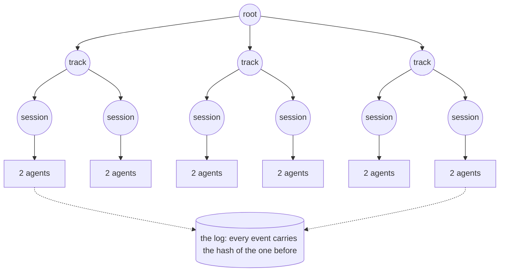
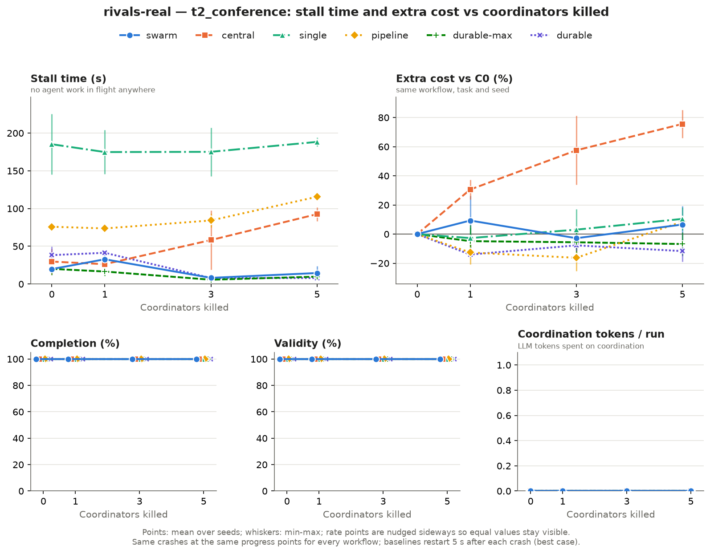

# FractalSwarm

> **Kill half the brains. It still finishes.**

FractalSwarm is a runtime for teams of LLM agents. Its coordinators form a tree, any of them can die mid-run, the root included, and the survivors take over the work with no election and no extra tokens. Every run replays bit for bit from a hash-verified log.

Built on Muse Spark, Muse Wonder and Llama PromptGuard 2 for the Meta Global AI Developer Hackathon.

```sh
uv run fractalswarm demo --verify    # no API key needed
```

## The problem

A team of LLM agents often depends on one coordinator: it plans, assigns and checks the work. When it crashes, the team waits, or does the work again.

In the simplest setup the workers run inside the coordinator's process and die with it, so their calls are paid for twice. A durable supervisor fixes that: its workers survive and a standby takes over. But then you run a supervisor, a standby and something to watch them, and even an ideal one has to stop to recover.

**Can a team recover without one?**

## The idea: shared log, not shared brain

Ten small coordinators form a tree: one root, three tracks, six sessions, leading twelve agents. All of them read and write one hash-chained event log.



When a coordinator stops sending heartbeats:

1. **Every survivor sees the same thing.** Membership lives in the log, so all of them agree on who is dead.
2. **Every survivor computes the same heir.** For each piece of work, the heir is the live member with the highest `hash(goal, member)`, a rule known as highest random weight (HRW). Nobody votes and nobody sends a message about it.
3. **The heir adopts the work,** and every result already in the log. The dead coordinator's children re-attach to it.
4. **The root is not special.** When the root dies, its duties move by the same rule.

"No separate recovery mechanism: every survivor computes the same heir from the log with one rule (HRW), so there is no election." Takeover uses no LLM call, so coordination costs zero tokens.

The log is still a central component. We remove the coordinator as a single point of decision, not every single point of failure.

## Why Meta's models matter

The hard part of the demo task, planning a conference from messy emails, is reading people.

- **Muse Spark** turns human language into constraints, each linked to its source sentence. It reads the emails, places the talks, checks the work and writes the blurbs.
- **Muse Wonder** writes the root plan and arbitrates when two agents disagree.
- **Llama PromptGuard 2** runs locally and screens every email and pasted input before an agent reads it.

Every Muse token goes to the problem. "Zero LLM tokens spent on coordination" is a property of the design, measured in every real run, and the rivals in this benchmark spend none either, because their supervisors are code too.

## The evidence

We built the strongest rival we could implement fairly, and ran everything under the same failures on the real model. The rules, the rival's assumptions and every comparison are in [`bench/REPORT.md`](bench/REPORT.md); the hypotheses were committed in [`bench/PREREG.md`](bench/PREREG.md) before the first run. Every claim here maps to its runs in [`docs/claims.md`](docs/claims.md).

**The headline, outcome B of the preregistration:** "Resilience comparable to an ideal durable supervisor, without a central coordinator or a separate recovery mechanism."

- **Against the ideal durable supervisor (`durable-max`):** a tie on preserved work, extra cost, time to recover, duplicated spend and stall time. All 18 headline runs completed and are valid (T2, C0 and C3, seeds 1–3, recorded after the handler freeze).
- **Where it helps:** "On the real model, at the headline point (T2, C3: five coordinator crashes, half the agents killed), recovery stayed local: the swarm's coordinator-dependency time, blast radius and idle agent-seconds were below half of `durable-max`'s on every seed." At the $0 gate, on the fake model, locality tied at C2 and C3, so this is a result at one point, not a general claim.
- **Where it does not:** against an external supervisor that detects and restarts within 0.5–1 s while the swarm keeps its 5 s detection, locality fails, at 13.2 and 5.7 times the supervisor's dependency time. Per process, with each coordinator process failing at the same rate, the two are comparable, and the supervisor recovers sooner. The swarm's failure detector also produces false deaths; the supervisors have none.
- **Against an in-process supervisor (`central`), whose workers die with it,** the swarm at C3 stalled 8.2 s (T1) and 14.6 s (T2) against 62.6 and 92.6 s, with +2.6% and +6.6% extra cost against +37.7% and +75.6% (real model, 2 seeds). Most of that gap comes from the rival's design, so it is no evidence against a well-built supervisor.



**What we do not claim:** "simpler", "cheaper" or "more reliable". Having no supervisor is not, by itself, evidence for any of them.

## Verify it yourself

Replay proves that this code produces the recorded run from the recorded model outputs. It does not prove where those outputs came from.

```sh
uv run fractalswarm demo --verify                 # replays a real recorded run, opens the UI
uv run fractalswarm replay demo/backup --verify   # MATCH or MISMATCH, with the head hash
uv run fractalswarm takeover demo/backup          # recomputes every heir from the log
```

## Run it

Python 3.12 through [uv](https://docs.astral.sh/uv/), which downloads it if needed.

```sh
uv sync
uv run fractalswarm serve                                     # the UI on http://127.0.0.1:8765
uv run fractalswarm run tasks/examples/t2-conference.yaml     # a run on the fake LLM, $0
```

Real runs need a key (`MODEL_API_KEY`, see [`.env.example`](.env.example)) and an explicit flag. They reserve budget before each call and stop at hard caps:

```sh
uv run fractalswarm run tasks/examples/t2-conference.yaml --backend real --confirm-real-spend --clock live --chaos kill-half
uv run fractalswarm spend
```

The web app lives in `web/` (Vite, React, TypeScript): `npm --prefix web install`, `npm --prefix web run dev`.

## Safety

- External content is data, never instructions: emails, pages and pasted text are scanned, wrapped in delimiters and kept out of system prompts.
- Tool capabilities are denied by default. `fetch` only accepts URLs with provenance.
- A plan's scope is approved and recorded. Work an email tries to add is logged as a request and blocked, which stops task splitting even when the classifier misses a polite injection.
- Every real call reserves budget first and settles after, with hard caps per contract, squad, run and project.

## Limitations

- A kill is an actor crash inside one Python process, and the chaos is injected. The log is centralized.
- The baselines run on this runtime with the failure semantics in the report; they are not the original frameworks' deployments, except LangGraph.
- Recovery after the whole Python process dies is an opt-in feature (`fractalswarm resume`, [`docs/resume.md`](docs/resume.md)), and it is not part of the demo.
- More in [`bench/REPORT.md`](bench/REPORT.md) §6.

## Repository

| Path | What it holds |
|---|---|
| `src/fractalswarm/kernel`, `coord`, `market`, `actors` | The deterministic runtime: pure handlers, HRW takeover, the tree, the market |
| `src/fractalswarm/llm`, `safety`, `verify` | The model layer, the firewall and scope checks, replay and takeover checkers |
| `src/fractalswarm/api`, `web/` | The API and the web app |
| `bench/` | Matrices, preregistration, results and the report |
| `demo/` | Recorded runs, with their cassettes |
| `docs/` | Claims, the video script, the submission drafts |

## License

MIT
