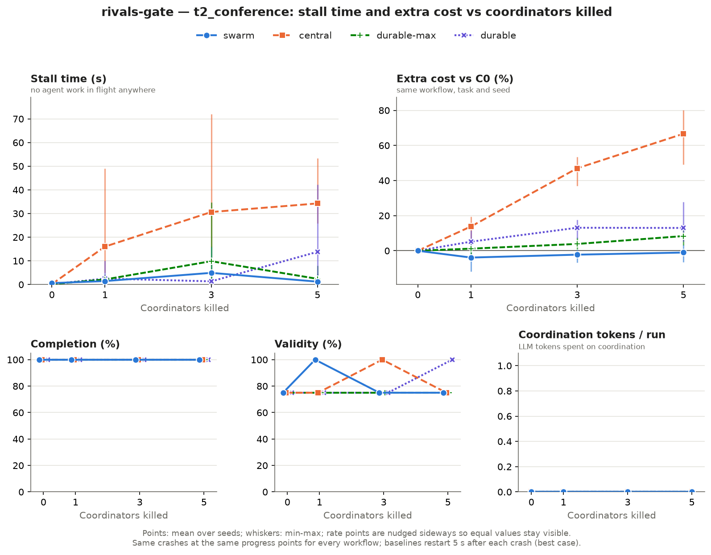
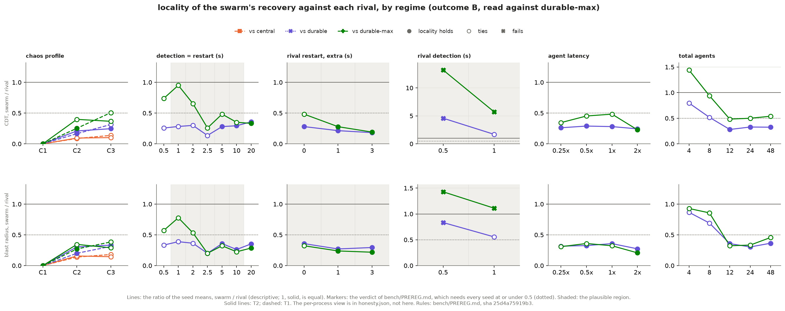
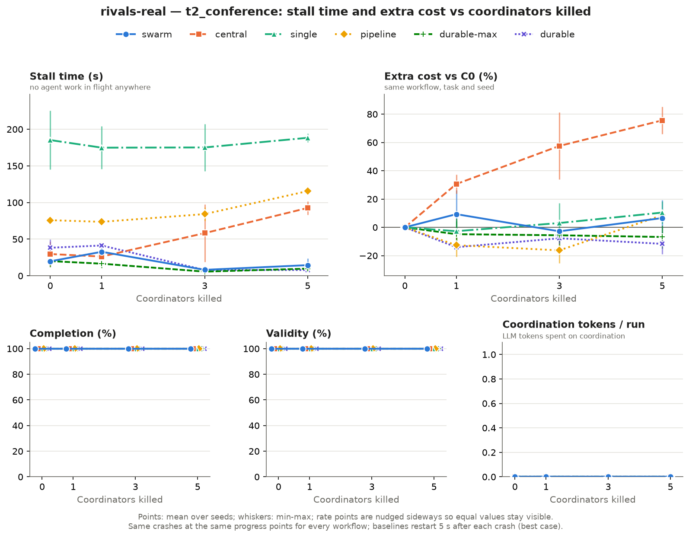
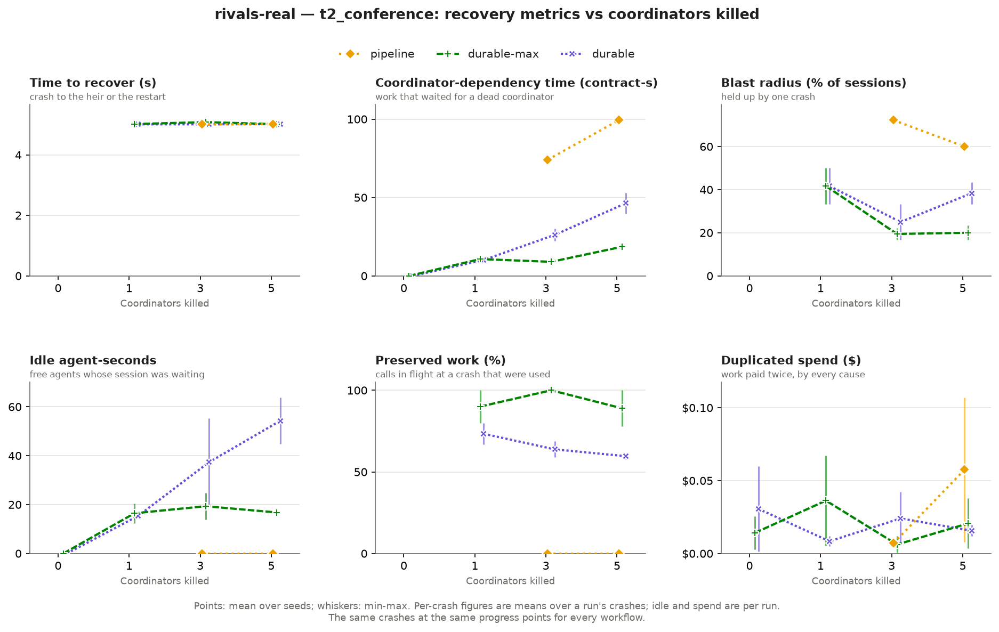
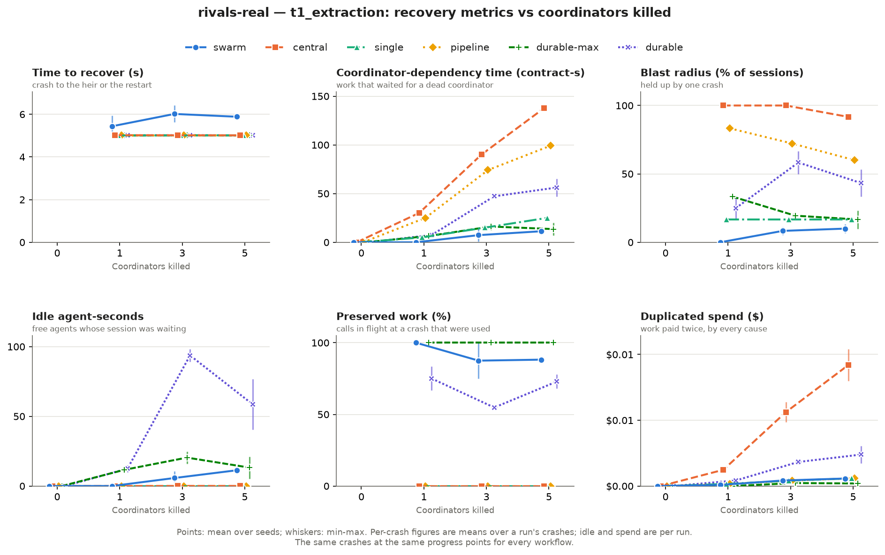
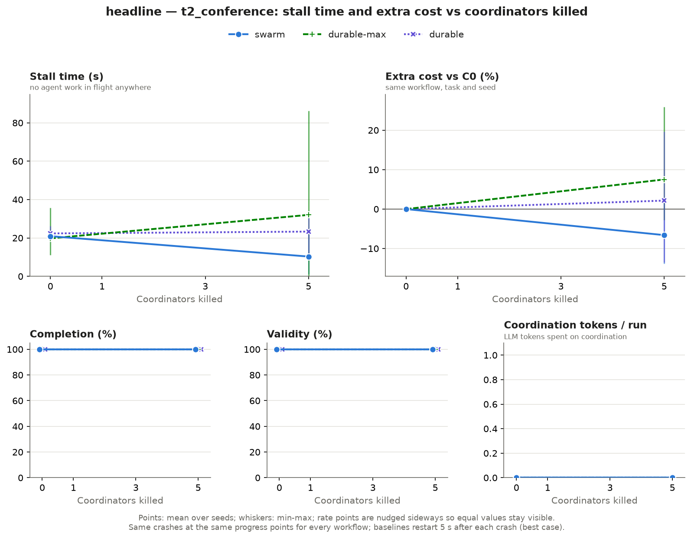
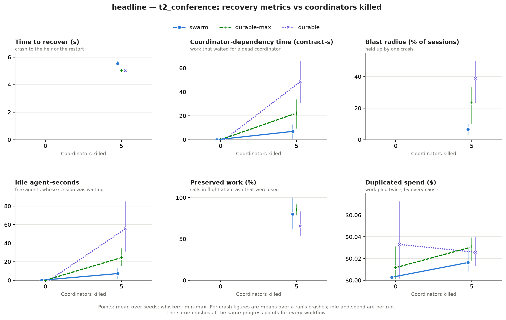

# FractalSwarm benchmark report

> Status: **the $0 sections, the headline, the reading in §5 and the results of the two real-model
> matrices run so far (§3, §4.10) are written; the results of §8 are not.** §4.1–§4.9 report the
> fake-LLM runs of the arena phase on the simulated clock: the rivals gate, the sensitivity sweeps,
> an exploratory crash-time jitter sweep, the per-process view and the false deaths. §4.10 reports
> the paid runs on the Meta Model API: 96 cells of six workflows and two tasks (`results/v1`, two
> seeds, descriptive) and the 18 cells of the headline matrix (`results/headline`, three seeds, read
> by the preregistered rules); §3 says what ran, on which models, at which commits and for how much.
> Every number in §3 and §4 is read from files committed under `bench/results/` (`results.csv`,
> `results.json`, `honesty.json`, `verdicts.txt`, the cell files), except where the text says it was
> computed from the run logs or the progress log, which are not committed with the results. Later
> real-model runs and the results of §8 are not written yet.

**Headline (decision gate, Oct 29: outcome B). Resilience comparable to an ideal durable
supervisor, without a central coordinator or a separate recovery mechanism.** Against
`durable-max`, stall time and extra cost tie at all six gate points, and locality ties on T2 at C2
and C3, so the stronger claim, that recovery stays local to the affected subtree, is not made
(§4.5, §4.9). Locality would hold where the supervisor needs 1–3 s more to restart a coordinator,
and it fails where an external supervisor detects and restarts within 0.5–1 s (§4.6). Per process
the two are comparable, and the supervisor recovers sooner (§4.7); the swarm's failure detector
produces false deaths, the supervisors' none (§4.8). Against the in-process supervisor
(`central`), whose workers die with it, the swarm stalls 1.2 s against 34.3 s and pays −1.0%
against +66.6% extra on T2 at C3 (§4.1, §4.2). What a headline may say is fixed in
`bench/PREREG.md` §7; the claims, each with its evidence, are in `docs/claims.md`.

## 1. Rivals and fairness rules (read these first)

Every workflow runs on the same runtime, models, tools, budgets and scoring. The rival gets
every advantage we can implement fairly; nothing here is a straw man.

### Workflows

- **`swarm`** (FractalSwarm): ten orchestrators in a depth-2 tree (root → tracks → sessions)
  lead 12 agents. When an orchestrator dies, the survivors re-own its work by deterministic
  hashing from the log: no supervisor, no election, and no LLM call.
- **`durable-max`** (the ideal durable supervisor): one coordinator, o0, with the same 12
  agents and the same log. When o0 crashes, its agents keep working; results sent while it is
  down are logged and adopted when it restarts, and so are its own plan and judge calls. It
  restarts 5 s after the crash, the restart takes 0 s, and recovery uses no LLM: a hot standby
  that takes over after a 5 s lease.
- **`durable`** (a realistic durable supervisor): the same, except that o0's own in-flight plan
  and judge calls are lost and redone after the restart, as in LangGraph or CrewAI supervisors.
- **`central`, the in-process supervisor** (reference row): the Phase 1 baseline, kept with this
  explanation. Its workers run inside its process, so a crash cancels their calls. In its real
  C3 run (`t2-real-c3-central-seed1`) it lost 27 calls:

  | Cause | Calls |
  |---|---|
  | Its own workers, stopped by the simulated process-tree stop | 19 |
  | Its own plan and judge calls, which a process death really loses (the swarm lost 1) | 5 |
  | Chaos agent kills, which hit every workflow (the swarm lost 2) | 3 |

  Its restarts then re-dispatched 22 contracts that the crashes had cancelled (`lost in a
  crash`) and adopted nothing from the log: the bench counts 42 calls in that run as paid
  twice, about $0.22 of its $0.601. That is more than the whole gap to the swarm in that run
  ($0.501 at C3, $0.454 at C0), which is therefore mostly a design artifact, not evidence
  against a well-built supervisor. (From the recorded log: `fractalswarm recovery
  t2-real-c3-central-seed1` shows the 5 own calls cancelled, the 34 workers stopped and the 42
  calls paid twice; the 19 and the 3 are the 22 cancelled worker calls grouped by the stop that
  cancelled each.)
- **`single`, `pipeline`, `langgraph`:** secondary rows.

### What we grant the rival

These assumptions are also shown as a caption in the arena and stated in the video. The
sensitivity sweep (§4) checks that the conclusion does not hinge on them.

| Assumption | Value in the main runs | Why | Checked by |
|---|---|---|---|
| Failure detection | 5 s, the same as the swarm's heartbeats | Same detector for both | Sweep {1, 2, 2.5, 5, 10 s}, symmetric; 0.5 s and 20 s as reported extremes |
| Restart or failover | 0 s after detection (an ideal hot standby) | Best case for the rival | Sweep {0, 1, 3 s} |
| Detection asymmetry | None | A process manager can see a crash at once, while heartbeats can't | "Fast external restart": rival at 0.5 s and 1 s, swarm at 5 s |
| False deaths | The simulated supervisors have no detector and no bus, so they are never declared dead by mistake; the swarm's detector can declare a live coordinator dead when its heartbeats are dropped, delayed or cut off | An advantage granted to the rival (`bench/PREREG.md` §5); it stays | The false deaths are counted at every setting (§4) |
| Workers | Survive the crash; results kept and adopted from the log | A well-built system runs workers apart | — |
| The rival's own LLM calls | `durable-max`: survive. `durable`: lost | Two variants bound the realistic range | Both rows |
| Shared state | The same durable log as the swarm | Same storage for both | — |
| Failure model | The same number of coordinator crashes at the same progress points (C1/C2/C3 = 1/3/5) | The existing chaos profiles | The per-process view (§4): the swarm runs 10 coordinator processes, the rival 1 |

### Fairness rules

1. **Same failures for everyone.**
   - Every workflow suffers the **same number of coordinator crashes at the same logical
     progress points**: C1 = 1, C2 = 3, C3 = 5 crashes, at 20/35/50/65/80% of contracts
     dispatched.
   - Each crash targets the coordinator with the most remaining owned work. In
     single-coordinator workflows that is always the same process; in the swarm it is a
     different orchestrator each time, so C3 means "half the brains".
   - The same share of agents (0/10/30/50%) is killed at the same points.
   - API and network faults use the same seeds.
2. **Best-case supervisor for the baselines.**
   - A crashed coordinator restarts **5 s after the crash**. That equals the swarm's own
     failure-detection latency (5 missed 1 s heartbeats). The restart itself takes 0 s.
   - All **completed** work is preserved through native persistence: the durable
     supervisors and central keep their logged results, LangGraph its checkpointer, single
     its transcript, pipeline its stage outputs.
   - No LLM re-planning is added unless the framework does it natively (LangGraph's
     supervisor re-reads state through the LLM).
3. **Process-tree semantics only in the reference rows.** In `central` and `langgraph`,
   workers run inside the supervisor's run, as in standard supervisor frameworks, so a
   supervisor crash cancels its in-flight worker calls. In `durable-max` and `durable`, as in
   the swarm, agents are independent: their work survives the crash and is adopted.
4. **Network faults** affect the bus-based workflows. LangGraph has no bus; its rows note
   that caveat.
5. **Every point is replayable.** Each row of `results.csv` names its run directory, and
   `fractalswarm replay <run_dir> --verify` rebuilds that run bit for bit.
6. **The rules are fixed before the runs.** The hypotheses and the minimum effects are
   committed in `bench/PREREG.md` before any gate run, and the rules are never changed to
   rescue a result. A difference counts only if every seed agrees and it reaches the minimum
   effect; otherwise it is a tie.

## 2. Metrics (all computed from the event log)

Definitions live in `src/fractalswarm/bench/scoring.py`; anyone can recompute them from a
run bundle.

| Metric | Definition |
|---|---|
| **Stall time (s)** | Within the work window (first agent LLM call start → last agent LLM call end), the virtual time during which **no agent LLM call is in flight anywhere**. A call is in flight from `effect.started` to its `effect.completed` or `effect.cancelled`; a call never closed counts until the run ends. Planner, judge and supervisor calls are not agent work. |
| **Extra cost vs C0 (%)** | `(cost(Ck) − cost(C0)) / cost(C0)`, same workflow, task and seed. Cost = sum of `cost_usd` of completed LLM calls, plus an estimate for calls cancelled or still in flight at the end: input billed in full, plus output so far (elapsed × the run's observed output rate for that role, capped at the full answer). Base latency is counted in the rate, so the estimate errs low. |
| **Time lost vs C0 (s)** | `makespan(Ck) − makespan(C0)`, same workflow, task and seed. |
| **Completion / validity** | From each task's deterministic checker (T2: 0 hard-constraint violations; T1: every value well-formed, every slot filled and F1 >= 0.9). |
| **Quality** | T2 soft score; T1 field-level F1. |
| **Coordination tokens** | LLM tokens of calls made to coordinate (roles `coordinator`, `supervisor`, `router`, `recovery`, or effect tags `coord:*`). Takeover in the swarm makes no LLM call. |
| **Messages / breaker trips** | `msg.sent` and `breaker.tripped` events. |

**Recovery metrics (v2, pre-registered).** Computed for every workflow; the exact readings
are fixed in `bench/PREREG.md` before the gate runs.

| Metric | Definition |
|---|---|
| **Work lost** | LLM calls cancelled or redone because a coordinator crashed, as calls and $. Separate from agent kills and API faults. |
| **Duplicated work** | Calls of a contract step already answered earlier, as calls and $. |
| **Unnecessary reassignments** | Re-dispatches while the assignee was alive, or while its result was already in the log. |
| **Time to recover, per crash** | From the crash to the first decision on the affected work (dispatch, judge or booking), and to its recovered throughput. |
| **Blast radius** | Share of agents and goals waiting on the dead coordinator, and the idle agent-seconds the crash causes (an agent idle while ready work waits for a down coordinator). |
| **Coordinator-dependency time** | Time during which ready work cannot proceed because its deciding coordinator is down. |

## 3. Setup

### The real-model runs

Two matrices ran on the Meta Model API with Contributor routing: **114 cells** in all, recorded from
Oct 28 to Oct 30 and read in §4.10. Every cell completed and is valid. The clock is live (`clock:
live` in all 114 run logs), so stall times, makespans, costs and call counts are those of the API on
the day each cell ran, and a new run would not repeat them.

| Item | Value |
|---|---|
| Matrices | **v1**, `bench/matrix-rivals-real.yaml`: swarm, `durable-max`, `durable`, `central`, `single` and `pipeline` × T2 and T1 × C0–C3 × seeds 1–2 = **96 cells**, in `bench/results/v1`. **Headline**, `bench/matrix-headline.yaml`: swarm, `durable-max` and `durable` × T2 × C0 and C3 × seeds 1–3 = **18 cells**, in `bench/results/headline`. The scenarios, chaos profiles and seeds in the 114 run logs are those of these cells. |
| The placeholder names | This section used to name `bench/matrix.yaml` and `bench/matrix-final.yaml`; neither is a matrix of record. `matrix.yaml` (chart v1: swarm, `central`, `single` and `pipeline` × T2 × C0–C3 × 2 seeds = 32 cells) recorded 29 of v1's cells on Oct 28 and was stopped with three `pipeline` cells left. `matrix-final.yaml` (the same four workflows × T2 and T1 = 64 cells) was not run. `matrix-rivals-real.yaml` replaced both: it writes to the same directory and skips a cell that has a result file, so it paid for the other 67 cells (32 for `durable-max` and `durable`, 32 for T1, and the 3 `pipeline` cells of chart v1). The headline has a directory of its own, because the harness would hand back v1's earlier cells instead of running new ones. |
| Models | Per role, read from the run logs: the table below. The root planner runs on `muse-wonder-1.0`, which has no Contributor variant. Every other role runs on `muse-spark-1.3` and goes to `muse-spark-1.3-contributor` when the call is opted in and the scanners find its content clean (spec §7.5). |
| Topology | swarm: depth 2, 10 orchestrators, 12 agents (fanout [3, 2], 2 agents per leaf, in every swarm log). `durable-max`, `durable` and `central`: 1 coordinator, 12 agents. `single` and `pipeline` (secondary rows): `central`'s process with one worker and one contract in flight at a time (`actors/orchestrator.py`). |
| Caps and pre-flight worst case | Run cap $0.50 on every cell (`run_cap_usd` in all 114 logs). The matrix cap is the worst case that `--dry-run` prints before a real run: **$33.50** for v1's 67 cells still to run (67 × $0.50) and **$9.00** for the headline (18 × $0.50). The 29 cells recorded first had $16.00 (`matrix.yaml`: 32 × $0.50). |
| Actual spend | **$21.21** for the 114 cells, as the API reported it for their completed calls: $16.06 for v1 and $5.15 for the headline (the table below). The 67 cells paid for under the $33.50 cap cost $7.69, and the headline $5.15 against its $9.00. Two runs that were cut and run again cost $0.40 more (below). |
| Commits | The code each block of cells ran on: the table below. |
| $0 gate (fake LLM) | Run: the next table and §4 |

**Models by role.** Completed calls of the 114 runs by role and model, with their cost, read from the
run logs (`effect.started` gives the role, `effect.completed` the model and the cost; the run bundles
are not committed). Prices are per 1M tokens, input / cached input / output (`config/prices.yaml`,
checked against Meta's pricing page on Oct 27).

| Role | Model | Price | Calls | Cost |
|---|---|---|---|---|
| root planner | `muse-wonder-1.0` | $4.00 / $0.20 / $20.00 | 123 | $5.245 |
| sub-planner | `muse-spark-1.3-contributor` | $0.10 / $0.002 / $0.20 | 828 | $0.196 |
| sub-planner | `muse-spark-1.3` | $1.25 / $0.15 / $4.25 | 198 | $3.128 |
| agent | `muse-spark-1.3-contributor` | $0.10 / $0.002 / $0.20 | 3,418 | $0.866 |
| agent | `muse-spark-1.3` | $1.25 / $0.15 / $4.25 | 1,827 | $11.439 |
| judge | `muse-spark-1.3-contributor` | $0.10 / $0.002 / $0.20 | 812 | $0.280 |
| | | | **7,206** | **$21.154** |

By model, `muse-spark-1.3-contributor` took 5,058 of the 7,206 calls (70%) and $1.34 (6%) of the
cost, `muse-spark-1.3` 2,025 calls (28%) and $14.57 (69%), and `muse-wonder-1.0` 123 calls (2%) and
$5.25 (25%). The 96 runs that log their routing (the 18 cells of the first block predate the log) hold
6,115 decisions: 4,504 "opted in and content is clean" (Contributor), 1,508 "scanners flagged PII or
secrets; kept on the Standard model", and 103 "the role ladder keeps root_planner at L0 on Standard".
The logs show 42 more calls that did not end normally (36 returned an incomplete answer, $0.057 in all,
and 6 ended in an error) and 406 that were cancelled (278 agent, 79 sub-planner and 49 judge calls: the
crashes and kills of the chaos profiles). There is no call on a coordination role (`coordinator`,
`supervisor`, `router`, `recovery`), which is why every coordination-token count in §4.10 is 0. This
table is computed from the logs, not from a committed file; the cost of each cell is in `results.csv`.

**Commits and spend of the cells.**

| Cells | Count | Recorded (CET) | Commit | Cost of the cells | Completed calls |
|---|---|---|---|---|---|
| swarm ×8, `central` ×8, `single` C0 ×2; T2 | 18 | Oct 28, 17:19–18:34 | `587c88f` | $5.958 | $5.475 |
| `single` ×6, `pipeline` ×5; T2 | 11 | Oct 28, 19:07–20:27 | `f13b20a` | $2.941 | $2.891 |
| `durable-max` ×8, `durable` ×8; T2 | 16 | Oct 29, 17:07–18:06 | `b66098b` | $4.614 | $4.538 |
| `durable-max` ×8, `durable` ×8; T1. `pipeline` ×3 (C2 seed 2, C3 seeds 1–2); T2 | 19 | Oct 29, 20:20–21:26 | `be9cd77` | $1.670 | $1.638 |
| swarm, `central`, `single`, `pipeline` ×8 each; T1 | 32 | Oct 29, 21:57 – Oct 30, 00:42 | `8cfc99e` | $1.553 | $1.517 |
| **v1** | **96** | | | **$16.736** | **$16.060** |
| **Headline**: swarm, `durable-max`, `durable` × T2 × C0, C3 × seeds 1–3 | 18 | Oct 30, 01:09–02:14 | `e307ca1` | $5.242 | $5.152 |
| **All** | **114** | | | **$21.978** | **$21.212** |

*Cost of the cells is the sum of `cost_usd` in `bench/results/v1/results.csv` and
`bench/results/headline/results.csv`; it counts an estimate for the calls that were cancelled (§2).
Completed calls is the sum of the `cost_usd` that the API reported for the completed calls, read from
the run logs (not committed): the 7,206 calls of the table of models, $21.154, and the 36 that returned
an incomplete answer, $0.057. The difference between the two columns is that estimate ($0.766 in
all). Totals are sums of the unrounded figures. The ledger (`fractalswarm spend`, read before and after each block; progress log)
agrees with the completed calls to the cent: $4.54, $1.64, $1.52 and $5.15 for the last four blocks, and
$3.06 for the evening of Oct 28, when it went from $8.7600 to $11.8194: the 11 cells of `f13b20a`
($2.891) and the cut `pipeline` run ($0.168). The $8.90 that the progress log gives for the first 29
cells is the sum of their `cost_usd`, estimate included; on the ledger's basis they cost $8.37.*

Each commit is the code that the progress log names for the start of its block. The logs agree with it:
the recording times fall in the block's window, the 18 cells of `587c88f` have no `security.routed`
event, the 11 of `f13b20a` have them and no `supervisor` or `intake` role in their role tables, and
every later log has both. The handlers froze at the tag `handler-freeze` (`a5e9609`). The cells of
`be9cd77` and `8cfc99e` ran on code with no difference under `src/fractalswarm` from the freeze
(built web assets aside), and the headline's `e307ca1` differs from it only in `web/`. The 16 T2
cells of `b66098b` ran before the last handler change, the answer path of the arbitration board
(`dedde57`), which bench runs do not switch on; bench-side code (tables, verdicts, profiles, harness)
changed too. **Replay.** A log replays on the code that recorded it. The headline's cells were
recorded after the freeze, and three of the 18 replay at HEAD: MATCH (progress log, Oct 30). Of the 29
cells of Oct 28, the Phase 0 check (progress log, Oct 29) found that the 18 of `587c88f` diverge at
HEAD at their first LLM call, because the `security.routed` events came later, so they replay at
their own commit and not at HEAD; 10 of the 11 of `f13b20a` MATCH at HEAD; and
`single__t2_conference__C1__s1` replays at no commit (a re-run under the same run id hit a ledger
error that never reached the cassette; later runs are fixed, this recording keeps the mismatch). The
other 67 cells of v1 were not replayed for this report.

Two runs were cut before they finished and run again from the start: `single` C1 seed 1 (a memory
incident on the machine, Oct 28, 18:40; $0.2357 settled) and `pipeline` C2 seed 2 (a pause at 20:30,
at 6 of 18 contracts; $0.1680 settled). Their partial runs are kept outside the results
(`runs/v1-interrupted`, not committed) and are not in any figure of §4.10.

### The $0 runs behind §4

Every number in §4 comes from runs of the fake LLM with calibrated latencies on the simulated
clock: no network, no real call, $0 of spend. **T2** is the conference schedule (six sessions,
each a chain of three contracts: extract, place, blurb) and **T1** the extraction task.

| Item | Value |
|---|---|
| Gate | `bench/matrix-rivals-gate.yaml`: swarm, durable-max, durable and central × T2 and T1 × C0–C3 × seeds 1–4 = **128 cells, 0 failed**. Detection is 5 s for every system, and the supervisors restart at once. |
| Chaos profiles | C0: none. C1: 1 coordinator crash, 10% of agents killed, 5% API faults, 5% message loss. C2: 3 crashes, 30% killed, 10% API faults, 10% message loss and a partition. C3: 5 crashes at 20/35/50/65/80% of the contracts dispatched, 50% killed, 20% API faults, 20% message loss and one 8 s partition. The crash points and agent kills are the same for every workflow; the bus faults (loss, duplication, delay, reordering, partition) reach only the swarm's bus, since the supervisors have none (§1, rule 4; PREREG §5). |
| Sensitivity sweeps | Six matrices, **378 cells**: swarm, durable-max and durable × T2 × C0 and C3 × seeds 1–3. `recovery_ms` {1, 2, 2.5, 5, 10, 20 s} (108) and {0.5 s} (18); `rival_restart_ms` {0, 1, 3 s} (54); `rival_recovery_ms` {0.5, 1 s} (36); `agent_latency_scale` {0.25, 0.5, 1, 2} (72); agents {4, 8, 12, 24, 48} (90). |
| Crash-time jitter (exploratory) | `bench/matrix-sweep-jitter.yaml`: swarm, durable-max and durable × T2 × C0 and C3 × seeds 1–4 × jitter of 0, ±5, ±10 and ±15 points of progress on the five crashes of C3 = **96 cells, 0 failed**. It is not in PREREG, so it is outside `sweeps/` and `honesty.json` (§4.6.1). |
| Per-process probes | **68 cells**, T2, seeds 1–4: the swarm at C0 and at ten single-crash probes `K-<target>` (44 cells), and the three supervisors at C0 and `K-o0` (24 cells). |
| Seeds | Gate, per-process probes and the jitter sweep: 1–4. Sweeps: 1–3. The default settings (5 s detection, no extra restart, 1× latency, 12 agents) are in the gate and in four of the sweeps (`recovery_ms` 5 s, `rival_restart_ms` 0, latency 1×, 12 agents), so the same cells are read twice, with different seeds: the locality ratios at T2 C3 against durable-max (cdt / blast / idle) are 0.37 / 0.29 / 0.47 at the gate (4 seeds) and 0.48 / 0.32 / 0.62 in the sweeps (seeds 1–3, identical in all four). |
| Rules | `bench/PREREG.md`, written before the first gate run and applied mechanically by `fractalswarm bench verdicts --prereg`; SHA `25d4a75919b3`. Ratio of the seed means, win, tie and loss are defined in §4. |
| Verdicts | Run over everything at commit `48601df` with a clean tree: `bench/results/honesty.json` (every comparison, losses and ties included), `verdicts.txt`, `regime.png`, `regime.json`. The gate alone gives `bench/results/rivals-gate/` the same files, where the outcome reads PENDING because it has no sweeps. The exploratory jitter sweep (§4.6.1) is in none of them. |
| Files | Each results directory holds `cells/`, `results.csv`, `results.json` and the charts. The run bundles (`runs/`, about 5 GB) are not committed; each row names its run directory, and `fractalswarm replay <run_dir> --verify` rebuilds a run bit for bit. The matrices are deterministic: the default cells recur in four sweeps and are identical in all four. |
| Cost of the runs | About 29 minutes of compute on one core in all, and 4.3 more for the exploratory jitter sweep (table below); peak working set 145 MB for the gate and up to 730 MB for the 0.5 s detection sweep. |

| Stage | Cells | Wall time | Peak memory |
|---|---|---|---|
| Gate | 128 | about 2 min + 125.5 s (two chunks) | 145 MB |
| `recovery_ms` 1–20 s | 108 | 348.7 s | 418 MB |
| `recovery_ms` 0.5 s | 18 | 225.6 s | 730 MB |
| `rival_restart_ms` | 54 | 123.2 s | 137 MB |
| `rival_recovery_ms` | 36 | 86.2 s | 130 MB |
| `agent_latency_scale` | 72 | 159.4 s | 146 MB |
| Agents (width) | 90 | 365.2 s | 561 MB |
| Per-process, swarm | 44 | 135.3 s | 147 MB |
| Per-process, supervisors | 24 | 31.2 s | 137 MB |
| Crash-time jitter (exploratory) | 96 | 260.5 s | 139 MB |

### Two facts about the setup

**At C0 the four systems start from the same run on T1, not quite on T2.** On T1 they make the same
46 LLM calls with the same cost and makespan on all four seeds. On T2 the swarm's makespan is 3.5–5.0 s
longer on all four seeds, and on seeds 2 and 3 it makes 3 and 4 more calls than the other three, which
are identical to each other:

| Task | Seed | swarm | durable-max | durable | central |
|---|---|---|---|---|---|
| T2 | 1 | 58 / 70.8 s / $0.294 | 58 / 65.8 s / $0.291 | 58 / 65.8 s / $0.291 | 58 / 65.8 s / $0.291 |
| T2 | 2 | 64 / 53.9 s / $0.301 | 61 / 50.0 s / $0.284 | 61 / 50.0 s / $0.284 | 61 / 50.0 s / $0.284 |
| T2 | 3 | 69 / 78.4 s / $0.323 | 65 / 73.5 s / $0.315 | 65 / 73.5 s / $0.315 | 65 / 73.5 s / $0.315 |
| T2 | 4 | 67 / 89.8 s / $0.389 | 67 / 86.3 s / $0.392 | 67 / 86.3 s / $0.392 | 67 / 86.3 s / $0.392 |
| T1 | 1 | 46 / 33.3 s / $0.170 | 46 / 33.3 s / $0.170 | 46 / 33.3 s / $0.170 | 46 / 33.3 s / $0.170 |
| T1 | 2 | 46 / 41.5 s / $0.201 | 46 / 41.5 s / $0.201 | 46 / 41.5 s / $0.201 | 46 / 41.5 s / $0.201 |
| T1 | 3 | 46 / 57.4 s / $0.179 | 46 / 57.4 s / $0.179 | 46 / 57.4 s / $0.179 | 46 / 57.4 s / $0.179 |
| T1 | 4 | 46 / 54.5 s / $0.158 | 46 / 54.5 s / $0.158 | 46 / 54.5 s / $0.158 | 46 / 54.5 s / $0.158 |

*Calls / makespan / cost of each C0 run.* There is no chaos event and no false death at C0. The extra
calls belong to one more re-dispatch of a `place` contract and its judge call (`place` is retried in
every system on T2, and the swarm retried it once more on seeds 2 and 3). The cause is not traced to
the end; a likely one is that the bus's latency changes the order in which colliding bookings reach
the schedule.

**Extra cost is measured against each system's own C0**, so on T2 the swarm's percentages start from
a base that is a little dearer than the others' ($0.327 against $0.320, §4.2). The other metrics do not
use C0.

## 4. Results

Everything in this section is from the $0 runs of §3 (fake LLM, simulated clock). A table value is
the mean over the seeds of one task, workflow and profile (gate: seeds 1–4; sweeps: seeds 1–3).
**T2** is the conference schedule and **T1** the extraction task. C1, C2 and C3 crash 1, 3 and 5
coordinators, which is half of the swarm's ten at C3. The metrics are defined in §2.

**How to read the verdicts.** *Win*, *tie* and *loss* are the swarm's against one rival, by the
rules of `bench/PREREG.md` (fixed before the runs): a seed is a win only if it reaches the minimum
effect, and a comparison is a win only if every seed is one; otherwise it is a tie, marked `*` when
the seeds disagree. **Locality** *holds* when the swarm wins the coordinator-dependency time (cdt) and
the blast radius and does not lose the idle agent-seconds; it *fails* when it loses cdt or blast;
otherwise it *ties*. Next to each locality verdict the tables print the **ratios of the seed means**,
swarm / rival, for cdt / blast / idle. They are *descriptive, no verdict*: a ratio of 0.40 can still
be a tie, because one seed misses the threshold.

### 4.1 Hero chart and stall time



*T2 at the gate, seeds 1–4: stall time and extra cost (top), completion, validity and coordination
tokens (bottom), against the coordinators killed (C0–C3 = 0, 1, 3, 5). Points are means over seeds,
whiskers min–max. The chart is T2's, and T1 is in the tables. The validity panel is explained in §4.4.*

Stall time (s), mean over seeds:

| Task | Workflow | C0 | C1 | C2 | C3 |
|---|---|---|---|---|---|
| T2 | swarm | 0.6 | 1.5 | 4.9 | 1.2 |
| T2 | durable-max | 0.2 | 2.1 | 9.9 | 2.4 |
| T2 | durable | 0.2 | 2.5 | 1.4 | 13.8 |
| T2 | central (in-process supervisor) | 0.2 | 16.0 | 30.6 | 34.3 |
| T1 | swarm | 0.6 | 5.8 | 1.3 | 14.8 |
| T1 | durable-max | 0.6 | 0.0 | 6.3 | 0.5 |
| T1 | durable | 0.6 | 0.9 | 1.4 | 20.9 |
| T1 | central (in-process supervisor) | 0.6 | 11.2 | 16.0 | 37.0 |

On T2 the swarm stalls less than `durable-max` at C2 and C3 (4.9 against 9.9 s, 1.2 against 2.4 s)
and about as much at C1 (1.5 against 2.1 s); `central` stalls 16–34 s, and `durable` 13.8 s at C3.
Stall time is reported and is not one of the hypotheses (PREREG §4). The tool reads it against
`durable-max` as a tie at all six gate points, since a win needs 3 s on every seed.

On T1 it reverses at C1 and C3: the swarm stalls 5.8 and 14.8 s against 0.0 and 0.5 s for
`durable-max`. This is reported as it is, and it comes from a few runs:

| Profile | Workflow | Seed 1 | Seed 2 | Seed 3 | Seed 4 | Mean |
|---|---|---|---|---|---|---|
| C1 | swarm | 2.8 | 16.0 | 1.6 | 2.7 | 5.8 |
| C1 | durable-max | 0.0 | 0.0 | 0.0 | 0.0 | 0.0 |
| C2 | swarm | 0.0 | 0.5 | 1.6 | 3.0 | 1.3 |
| C2 | durable-max | 1.5 | 20.5 | 0.0 | 3.0 | 6.3 |
| C3 | swarm | 22.2 | 0.0 | 37.1 | 0.0 | 14.8 |
| C3 | durable-max | 0.0 | 1.9 | 0.0 | 0.0 | 0.5 |

*Stall time (s) of each T1 run.* Three runs carry it, and in each the stall is mostly one stretch in
which no agent call is in flight but a coordinator-side call is. T1 C1 seed 2 is one stretch of
15.95 s with one judge call in flight; the swarm's cdt is 0.00 at T1 C1, so no work waited for a dead
coordinator. T1 C3 seed 1 is one stretch of 22.19 s, again with one judge call in flight. T1 C3
seed 3 has 32.67 of its 37.12 s in one stretch with three sub-planner calls in flight, in a run whose
root planner call took 64.0 s (two attempts: an injected 503 overload with a 60 s Retry-After) against
3.9 s in `durable-max`, `durable` and `central` (§6, unpaired API faults). Stall time counts only the
gaps with no agent call in flight, so a long planner or judge call shows up as stall.

### 4.2 Extra cost

Extra cost against the same system's own C0 (%), mean over seeds:

| Task | Workflow | C1 | C2 | C3 |
|---|---|---|---|---|
| T2 | swarm | -3.9 | -2.2 | -1.0 |
| T2 | durable-max | 1.2 | 3.9 | 8.4 |
| T2 | durable | 5.2 | 13.1 | 13.0 |
| T2 | central (in-process supervisor) | 13.8 | 47.0 | 66.6 |
| T1 | swarm | 0.7 | 2.3 | 5.7 |
| T1 | durable-max | 0.8 | 2.9 | 3.0 |
| T1 | durable | 3.4 | 9.9 | 12.5 |
| T1 | central (in-process supervisor) | 8.2 | 36.0 | 65.6 |

The same costs in dollars, C0 included, so that both readings are visible:

| Task | Workflow | C0 | C1 | C2 | C3 |
|---|---|---|---|---|---|
| T2 | swarm | 0.327 | 0.315 | 0.319 | 0.324 |
| T2 | durable-max | 0.320 | 0.323 | 0.333 | 0.347 |
| T2 | durable | 0.320 | 0.336 | 0.361 | 0.361 |
| T2 | central (in-process supervisor) | 0.320 | 0.363 | 0.471 | 0.537 |
| T1 | swarm | 0.177 | 0.178 | 0.181 | 0.187 |
| T1 | durable-max | 0.177 | 0.179 | 0.182 | 0.183 |
| T1 | durable | 0.177 | 0.183 | 0.195 | 0.199 |
| T1 | central (in-process supervisor) | 0.177 | 0.192 | 0.241 | 0.292 |

On T2 the swarm's extra cost is negative and the rivals' is positive. The swarm's C0 is also a little
dearer than theirs ($0.327 against $0.320, §3), so its percentages start from a different base. In
dollars at C3 the swarm's mean is $0.324 against $0.347 for `durable-max`. By the preregistered
rule (PREREG §3: a difference of 5 points on every seed) H2 is a tie against `durable-max` at all six
gate points (§4.5), so the gate does not support the word *cheaper* (PREREG §7; `docs/claims.md`,
"Not claimed").

### 4.3 Recovery, per crash

Per-crash values are means over the run's crashes, then over seeds. Idle agent-seconds, calls
cancelled, paid twice and false deaths are per run. *Calls cancelled* is every cancelled LLM call of
the run, whatever the cause (a coordinator crash, a killed agent, a worker stopped with its
coordinator); *paid twice* is the cost of work done again, by any cause. *Time to recover* for the
supervisors is their configured restart delay, 5 s: an input, not a measurement. The swarm's is
measured, from the crash to its heir.

C2 (three coordinator crashes):

| Task | Workflow | Idle agent-s | Dependency time (s) | Time to recover (s) | Blast (% of sessions) | Preserved (%) | Calls cancelled | Paid twice ($) | False deaths |
|---|---|---|---|---|---|---|---|---|---|
| T2 | swarm | 11.0 | 7.9 | 5.48 | 13.9 | 93.8 | 0.8 | 0.006 | 1.25 |
| T2 | durable-max | 29.4 | 19.7 | 5.00 | 40.3 | 96.9 | 1.0 | 0.016 | 0.00 |
| T2 | durable | 59.0 | 37.6 | 5.00 | 45.8 | 66.4 | 5.2 | 0.043 | 0.00 |
| T2 | central (in-process supervisor) | 0.0 | 83.8 | 5.00 | 88.9 | 0.0 | 16.8 | 0.157 | 0.00 |
| T1 | swarm | 11.3 | 7.8 | 5.33 | 13.9 | 100.0 | 1.5 | 0.003 | 1.50 |
| T1 | durable-max | 60.1 | 30.9 | 5.00 | 51.4 | 100.0 | 2.0 | 0.004 | 0.00 |
| T1 | durable | 93.6 | 47.3 | 5.00 | 69.4 | 67.3 | 7.2 | 0.017 | 0.00 |
| T1 | central (in-process supervisor) | 0.0 | 90.0 | 5.00 | 100.0 | 0.0 | 18.0 | 0.063 | 0.00 |

C3 (five):

| Task | Workflow | Idle agent-s | Dependency time (s) | Time to recover (s) | Blast (% of sessions) | Preserved (%) | Calls cancelled | Paid twice ($) | False deaths |
|---|---|---|---|---|---|---|---|---|---|
| T2 | swarm | 17.4 | 12.0 | 5.99 | 10.8 | 90.5 | 2.2 | 0.015 | 2.25 |
| T2 | durable-max | 36.7 | 32.9 | 5.00 | 37.5 | 94.8 | 2.5 | 0.031 | 0.00 |
| T2 | durable | 50.6 | 48.8 | 5.00 | 32.5 | 68.9 | 7.8 | 0.053 | 0.00 |
| T2 | central (in-process supervisor) | 0.0 | 118.8 | 5.00 | 75.0 | 0.0 | 23.8 | 0.219 | 0.00 |
| T1 | swarm | 19.8 | 19.0 | 5.89 | 16.7 | 94.1 | 2.5 | 0.008 | 1.50 |
| T1 | durable-max | 47.8 | 37.5 | 5.00 | 43.3 | 100.0 | 2.0 | 0.005 | 0.00 |
| T1 | durable | 75.9 | 60.6 | 5.00 | 53.3 | 74.4 | 8.5 | 0.022 | 0.00 |
| T1 | central (in-process supervisor) | 0.0 | 138.8 | 5.00 | 92.5 | 0.0 | 27.8 | 0.114 | 0.00 |

### 4.4 Secondary: completion, validity, coordination tokens

All profiles pooled, 16 runs per row:

| Task | Workflow | Completion | Validity | Coordination tokens / run | Makespan (s) | Cost ($) |
|---|---|---|---|---|---|---|
| T2 | swarm | 100% | 81% | 0 | 104.4 | 0.321 |
| T2 | durable-max | 100% | 75% | 0 | 100.6 | 0.331 |
| T2 | durable | 100% | 81% | 0 | 114.6 | 0.344 |
| T2 | central (in-process supervisor) | 100% | 81% | 0 | 126.4 | 0.423 |
| T1 | swarm | 100% | 100% | 0 | 83.2 | 0.181 |
| T1 | durable-max | 100% | 100% | 0 | 70.8 | 0.180 |
| T1 | durable | 100% | 100% | 0 | 74.0 | 0.189 |
| T1 | central (in-process supervisor) | 100% | 100% | 0 | 85.9 | 0.225 |

Every run completed, and no workflow spends LLM tokens on coordination (the swarm's takeover makes no
LLM call). T2 validity is below 100% for every workflow, and **all 13 invalid cells are T2 seed 3**:
the checker reports `placed 40/48, hard violations 8, gaps 2` for all four workflows at C0 on that
seed, and at 9 of its 12 chaos cells, in the gate's configuration (default routing). It is a property
of that seed's fake outputs, not of the chaos (the cause is not traced). It is also why
`durable-max`, invalid on all four profiles of seed 3, reads 75% and the others 81%. It does not
carry over to other configurations. The $0 rehearsal of the headline matrix, run with Contributor
routing (`.plans/notes/arena-rival.md`, Part 9; not committed as results), has all six of its seed-3
cells valid (T2, swarm, `durable-max` and `durable` at C0 and C3, against one of six at the gate), and
so has the real model: the six seed-3 cells of the headline are valid, five of them with the top score
(§4.10.5). Why the fake outputs change with the flag is not traced.

### 4.5 Verdicts at the gate

Swarm wins / ties / losses over the six gate points (T1 and T2 at C1, C2, C3), by hypothesis
(PREREG §4):

| Hypothesis | vs durable-max | vs durable | vs central |
|---|---|---|---|
| H1 Preserved work | 0 / 6 / 0 | 3 / 3 / 0 | 6 / 0 / 0 |
| H2 Extra cost (%) | 0 / 6 / 0 | 2 / 4 / 0 | 6 / 0 / 0 |
| H3 Time to recover (s) | 0 / 6 / 0 | 0 / 6 / 0 | 0 / 6 / 0 |
| H4a Dependency time (s) | 3 / 3 / 0 | 5 / 1 / 0 | 6 / 0 / 0 |
| H4b Blast radius (% sessions) | 5 / 1 / 0 | 6 / 0 / 0 | 6 / 0 / 0 |
| H4c Idle agent-seconds | 3 / 3 / 0 | 5 / 1 / 0 | 0 / 2 / 4 |
| H5 Unnecessary reassignments | 0 / 2 / 4 | 0 / 2 / 4 | 0 / 2 / 4 |
| H6 Duplicated spend (points) | 0 / 6 / 0 | 0 / 6 / 0 | 6 / 0 / 0 |
| S Stall time (s), not a hypothesis | 0 / 6 / 0 | 0 / 6 / 0 | 2 / 4 / 0 |

Against `durable-max`, the rival that decides the outcome, the swarm's wins are all in locality: the
blast radius at 5 of 6 points, and cdt and idle agent-seconds at 3 of 6. Everything else is a tie
(H1, H2, H3, H6, stall) except H5, which is a loss at the four points with chaos beyond C1: the
swarm's detector declares live coordinators dead and re-owns their work (§4.8), and the supervisors
have no detector. The whole comparison on T2, as *verdict (swarm / rival)*:

|  | C1 | C2 | C3 |
|---|---|---|---|
| H1 Preserved work | tie (100.00 / 100.00) | tie* (93.75 / 96.88) | tie (90.53 / 94.83) |
| H2 Extra cost (%) | tie* (-3.87 / 1.20) | tie* (-2.23 / 3.88) | tie* (-1.02 / 8.37) |
| H3 Time to recover (s) | tie (4.69 / 5.00) | tie* (5.48 / 5.00) | tie* (5.99 / 5.00) |
| H4a Dependency time (s) | win (0.00 / 5.47) | tie* (7.85 / 19.73) | tie* (12.03 / 32.86) |
| H4b Blast radius (% sessions) | win (0.00 / 25.00) | win (13.89 / 40.28) | win (10.83 / 37.50) |
| H4c Idle agent-seconds | win (0.00 / 6.06) | tie* (10.97 / 29.42) | tie* (17.41 / 36.73) |
| H5 Unnecessary reassignments | tie (0.00 / 0.00) | loss (1.25 / 0.00) | loss (2.25 / 0.00) |
| H6 Duplicated spend (points) | tie (0.00 / 0.00) | tie (0.00 / 0.00) | tie (1.34 / 0.00) |
| S Stall time (s), not a hypothesis | tie* (1.46 / 2.15) | tie* (4.93 / 9.86) | tie* (1.22 / 2.40) |

The other five grids are in Appendix A.

**Locality at the gate**, with the ratios of the seed means (swarm / rival; cdt / blast / idle;
descriptive, no verdict):

| Task | Profile | vs durable-max | vs durable | vs central |
|---|---|---|---|---|
| T1 | C1 | holds: 0.00 / 0.00 / 0.00 | holds: 0.00 / 0.00 / 0.00 | holds: 0.00 / 0.00 / - |
| T1 | C2 | holds: 0.25 / 0.27 / 0.19 | holds: 0.17 / 0.20 / 0.12 | ties: 0.09 / 0.14 / - |
| T1 | C3 | ties: 0.51 / 0.38 / 0.41 | ties: 0.31 / 0.31 / 0.26 | ties: 0.14 / 0.18 / - |
| T2 | C1 | holds: 0.00 / 0.00 / 0.00 | holds: 0.00 / 0.00 / 0.00 | holds: 0.00 / 0.00 / - |
| T2 | C2 | ties: 0.40 / 0.34 / 0.37 | holds: 0.21 / 0.30 / 0.19 | ties: 0.09 / 0.16 / - |
| T2 | C3 | ties: 0.37 / 0.29 / 0.47 | holds: 0.25 / 0.33 / 0.34 | ties: 0.10 / 0.14 / - |

Against `durable-max` locality holds at C1 on both tasks and at T1 C2, and it ties at T1 C3 and at
**T2 C2 and C3**, the two points that decide the outcome (§4.9). At those two points the ratios of
the seed means are all below 0.5, yet the verdict is a tie, because not every seed reaches the
threshold (a seed is a win when the swarm's value is at most half the rival's and the rival's is above
the floor):

| Profile | Metric | Seed 1 | Seed 2 | Seed 3 | Seed 4 |
|---|---|---|---|---|---|
| C2 | cdt | 6.8 / 10.4 = 0.66 (no win) | 8.9 / 23.8 = 0.37 | 8.4 / 24.2 = 0.35 | 7.2 / 20.5 = 0.35 |
| C2 | blast | 11.1 / 22.2 = 0.50 | 16.7 / 44.4 = 0.38 | 16.7 / 50.0 = 0.33 | 11.1 / 44.4 = 0.25 |
| C2 | idle | 13.7 / 17.0 = 0.80 (no win) | 9.8 / 44.4 = 0.22 | 14.4 / 32.2 = 0.45 | 6.0 / 24.0 = 0.25 |
| C3 | cdt | 12.3 / 28.6 = 0.43 | 13.0 / 25.3 = 0.51 (no win) | 16.0 / 31.5 = 0.51 (no win) | 6.9 / 46.0 = 0.15 |
| C3 | blast | 10.0 / 36.7 = 0.27 | 10.0 / 26.7 = 0.38 | 13.3 / 40.0 = 0.33 | 10.0 / 46.7 = 0.21 |
| C3 | idle | 16.9 / 34.3 = 0.49 | 23.0 / 29.9 = 0.77 (no win) | 16.0 / 26.0 = 0.61 (no win) | 13.7 / 56.7 = 0.24 |

*Swarm / durable-max = ratio, per seed, T2.* At C2 seed 1 misses on cdt (0.66) and idle (0.80); at C3
seeds 2 and 3 miss on cdt (0.51 each) and on idle (0.77, 0.61). The blast radius is a win on all four
seeds at both profiles. The rule was fixed before the runs and is applied as written, and no seeds
were added after these readings.

**Cost (H2), seed by seed on T2.** The swarm's extra cost is lower than `durable-max`'s on every seed
at C2 and C3, but by the 5 points H2 needs on only three of the four seeds at each of C2 and C3 (C2
seed 1: 0.36; C3 seed 4: 4.89, which is 0.11 short), so H2 is a tie. In dollars the swarm's C3 run is
cheaper on all four seeds ($0.282–$0.402 against $0.308–$0.424), its scores are equal or higher at
C3, and it preserves less of the work in flight on seeds 2–4. No verdict is attached to the dollars:
the two systems' C0 bases differ (§3).

| Profile | Seed | Swarm extra cost (%) | durable-max extra cost (%) | Difference (points) | Cost, swarm / durable-max ($) | Preserved, swarm / durable-max (%) | Score, swarm / durable-max |
|---|---|---|---|---|---|---|---|
| C2 | 1 | 0.54 | 0.89 | 0.36 | 0.295 / 0.293 | 100 / 100 | 0.833 / 0.889 |
| C2 | 2 | -6.78 | 3.50 | 10.28 | 0.281 / 0.294 | 100 / 100 | 0.760 / 0.720 |
| C2 | 3 | -0.38 | 7.56 | 7.94 | 0.322 / 0.339 | 100 / 94 | 0.818 / 0.818 |
| C2 | 4 | -2.30 | 3.55 | 5.85 | 0.380 / 0.406 | 75 / 94 | 0.826 / 0.870 |
| C3 | 1 | 1.08 | 13.42 | 12.34 | 0.297 / 0.330 | 100 / 96 | 0.833 / 0.833 |
| C3 | 2 | -6.44 | 8.62 | 15.06 | 0.282 / 0.308 | 88 / 96 | 0.760 / 0.720 |
| C3 | 3 | -2.09 | 3.15 | 5.24 | 0.317 / 0.325 | 86 / 92 | 0.818 / 0.818 |
| C3 | 4 | 3.39 | 8.27 | 4.89 | 0.402 / 0.424 | 89 / 96 | 0.870 / 0.826 |

**The central row, and idle agent-seconds (H4c).** Against `central` the swarm wins preserved work,
extra cost, cdt, blast radius and duplicated spend (H1, H2, H4a, H4b, H6) at all six gate points. Next
to those, central's cost is visible in §4.3: 16.8–27.8 calls cancelled per run at C2–C3, $0.063–$0.219
paid twice, an extra cost of 36–67% (H2) and 34–61 points of duplicated spend (H6). Against `central`
the swarm does not win H4c, and loses it at C2 and C3: central's idle agent-seconds is 0.00 in
every run **by construction**, because its workers run inside its process and stop with it, so no
agent is alive and idle while a session waits. That loss makes locality read *ties* rather than
*holds* against `central` at C2 and C3, although the swarm wins cdt and blast on every seed at all
six points. It is a property of how the reference row is built, not a finding about recovery, and so
is its 0% of preserved work (H1).

### 4.6 Sensitivity sweeps ($0)

Does the conclusion hinge on what we grant the rival? Each sweep moves one assumption on T2 at C3 (every
cell has a C0 twin), the swarm against `durable-max` and `durable`, on seeds 1–3. Settings in the
**plausible region** decide the outcome (PREREG §5, fixed before the runs); the symmetric extremes and the
workload sweeps are reported as conditions and decide nothing. Locality of the swarm against
`durable-max`, with the ratios of the seed means (descriptive):

| Sweep | Setting | In the plausible region | Locality (PREREG) | cdt | blast | idle |
|---|---|---|---|---|---|---|
| detection = restart | 0.5 s | no | ties | 0.74 | 0.57 | 0.23 |
| detection = restart | 1 s | yes | ties | 0.95 | 0.78 | 0.84 |
| detection = restart | 2 s | yes | ties | 0.65 | 0.53 | 0.77 |
| detection = restart | 2.5 s | yes | ties | 0.26 | 0.20 | 0.20 |
| detection = restart | 5 s | yes | ties | 0.48 | 0.32 | 0.62 |
| detection = restart | 10 s | yes | ties | 0.35 | 0.22 | 0.36 |
| detection = restart | 20 s | no | holds | 0.33 | 0.29 | 0.39 |
| rival restart, extra | 0 s | yes | ties | 0.48 | 0.32 | 0.62 |
| rival restart, extra | 1 s | yes | holds | 0.28 | 0.24 | 0.31 |
| rival restart, extra | 3 s | yes | holds | 0.19 | 0.22 | 0.21 |
| rival detection (fast external restart) | 0.5 s | yes | fails | 13.20 | 1.43 | 25.32 |
| rival detection (fast external restart) | 1 s | yes | fails | 5.71 | 1.11 | 10.37 |
| agent latency | 0.25x | no | ties | 0.34 | 0.31 | 0.34 |
| agent latency | 0.5x | no | ties | 0.45 | 0.36 | 0.38 |
| agent latency | 1x | no | ties | 0.48 | 0.32 | 0.62 |
| agent latency | 2x | no | holds | 0.23 | 0.21 | 0.19 |
| total agents | 4 | no | ties | 1.44 | 0.93 | 1.32 |
| total agents | 8 | no | ties | 0.94 | 0.86 | 1.03 |
| total agents | 12 | no | ties | 0.48 | 0.32 | 0.62 |
| total agents | 24 | no | ties | 0.50 | 0.33 | 0.46 |
| total agents | 48 | no | ties | 0.54 | 0.46 | 0.53 |



*The regime map: lines are the ratios of the seed means (descriptive), markers the PREREG verdict.*

- **Detection = restart (`recovery_ms`).** Locality ties at every plausible setting (1–10 s) and at
  0.5 s, and holds at 20 s. At 1 s the ratios are 0.95 / 0.78 / 0.84: with that detection time the
  swarm's cdt is about the supervisor's. Short detection also makes the swarm's detector fire on live
  coordinators (§4.8): at 0.5 s there are 24.7 false deaths per run, and H6 is a loss (30.6 points of
  duplicated spend against 0.0).
- **Rival restart (`rival_restart_ms`).** Locality ties at 0 s, the default, and holds at 1 s and 3 s:
  the cdt ratio falls from 0.48 to 0.28 to 0.19 as the supervisor takes longer to come back.
- **Fast external restart (`rival_recovery_ms`, 0.5 and 1 s).** Locality **fails**. The supervisor is
  back after 0.5 or 1 s while the swarm keeps its 5 s detection, so the swarm's cdt is 13.2 and 5.7
  times the supervisor's (13.75 s against 1.04 and 2.41 s). PREREG §5 put this case in the plausible
  region on purpose, and it is the only sweep in which locality fails.
- **Agent latency (`agent_latency_scale`).** Ties at 0.25×–1× and holds at 2×. A workload condition.
- **Width (agents).** Ties at every width. The cdt ratio is 1.44 at 4 agents and 0.94 at 8, so at
  those widths the swarm's cdt is not lower than the supervisor's; from 12 to 48 agents it is 0.48–0.54. A
  workload condition.

Charts of each sweep (six panels along the sweep's axis, T2 at C3):
[`recovery_ms`](results/sweeps/recovery_ms/recovery-t2_conference-recovery_ms.png),
[`recovery_ms` 0.5 s](results/sweeps/recovery_ms_extreme/recovery-t2_conference-recovery_ms.png),
[`rival_restart_ms`](results/sweeps/rival_restart_ms/recovery-t2_conference-rival_restart_ms.png),
[`rival_recovery_ms`](results/sweeps/rival_recovery_ms/recovery-t2_conference-rival_recovery_ms.png),
[`agent_latency_scale`](results/sweeps/agent_latency_scale/recovery-t2_conference-agent_latency_scale.png),
[agents](results/sweeps/agents/recovery-t2_conference-agents.png) and the
[width scaling chart](results/sweeps/agents/scaling-t2_conference.png). The same table against
`durable`, the weaker rival, is in Appendix B.

**Every hypothesis over every point.** Swarm wins / ties / losses over the 27 points (6 gate points and
21 sweep points; `central` is in the gate only, so 6 points):

| Hypothesis | vs durable-max | vs durable | vs central |
|---|---|---|---|
| H1 Preserved work | 0 / 23 / 4 | 11 / 16 / 0 | 6 / 0 / 0 |
| H2 Extra cost (%) | 9 / 18 / 0 | 16 / 11 / 0 | 6 / 0 / 0 |
| H3 Time to recover (s) | 1 / 22 / 4 | 1 / 22 / 4 | 0 / 6 / 0 |
| H4a Dependency time (s) | 8 / 17 / 2 | 19 / 7 / 1 | 6 / 0 / 0 |
| H4b Blast radius (% sessions) | 15 / 12 / 0 | 19 / 8 / 0 | 6 / 0 / 0 |
| H4c Idle agent-seconds | 9 / 16 / 2 | 16 / 9 / 2 | 0 / 2 / 4 |
| H5 Unnecessary reassignments | 0 / 7 / 20 | 0 / 7 / 20 | 0 / 2 / 4 |
| H6 Duplicated spend (points) | 0 / 26 / 1 | 9 / 18 / 0 | 6 / 0 / 0 |
| S Stall time (s), not a hypothesis | 2 / 25 / 0 | 9 / 18 / 0 | 2 / 4 / 0 |

**Where the swarm loses against `durable-max`**, H5 aside (H5 is a loss at 20 of the 27 points, the false
deaths of §4.8):

- **H1, Preserved work:** total agents 4 (73.22 against 91.11); total agents 24 (75.40 against 96.76); detection = restart 1 s (67.65 against 95.70); detection = restart 2 s (80.09 against 97.10).
- **H3, Time to recover (s):** total agents 4 (7.83 against 5.00); detection = restart 20 s (26.78 against 20.00); rival detection (fast external restart) 0.5 s (5.93 against 0.50); rival detection (fast external restart) 1 s (5.93 against 1.00).
- **H4a, Dependency time (s):** rival detection (fast external restart) 0.5 s (13.75 against 1.04); rival detection (fast external restart) 1 s (13.75 against 2.41).
- **H4c, Idle agent-seconds:** rival detection (fast external restart) 0.5 s (18.63 against 0.74); rival detection (fast external restart) 1 s (18.63 against 1.80).
- **H6, Duplicated spend (points):** detection = restart 0.5 s (30.59 against 0.00).

**H2 over the sweeps, and why it does not carry a cost claim.** H2 against `durable-max` is 9 wins at the 21
sweep points and none at the 6 gate points. Seven of the nine use the default swarm cells (the same cells
counted at 1× latency, 12 agents, `recovery_ms` 5 s, `rival_recovery_ms` 0.5 and 1 s, and
`rival_restart_ms` 0 and 1 s), and the other two are 24 agents and `recovery_ms` 2.5 s. Those cells
have seeds 1–3. With the gate's fourth seed the same cells are a tie: at T2 C3 the difference per
seed (durable-max minus swarm, in points of extra cost) is 12.34, 15.06, 5.24 and 4.89 against a
minimum effect of 5. PREREG §7 allows *cheaper* only for an H2 win against the same rival under the
same failures, and the preregistered gate has none.

#### 4.6.1 Crash-time jitter (exploratory, not pre-registered)

Does the comparison hinge on the five crashes landing at 20/35/50/65/80% of the contracts dispatched?
This sweep moves each coordinator crash of C3 by a seeded displacement of up to ±5, ±10 or ±15 points
of progress. T2 has 18 contracts, so a point is 0.18 of a contract. The displacements depend on the
seed alone, so every workflow of a seed gets the same crash times; the rest of the plan (the agent kills,
the partition, the bus faults and the API-fault rate) is unchanged. The matrix is
`bench/matrix-sweep-jitter.yaml`: swarm, durable-max and durable × T2 × C0 and C3 × seeds 1–4 × four
settings = **96 cells, 0 failed**, 260.5 s, peak 139 MB, $0, in `bench/results/exploratory/crash_jitter_pct/`
(its run bundles, 665 MB, are not committed). Two checks that the knob changes nothing else: setting 0 is
the gate's plan spelled out, and its 24 cells equal the gate's cells in every metric; at C0 there is no
crash to move, and the 36 C0 cells of the other three settings equal the 12 of setting 0.

**It is exploratory.** PREREG §5 fixes C3's crash points and does not list this sweep, so no setting is in
the plausible region, and nothing here is in `honesty.json`, in the tallies of §4.5 and §4.6 or in the
derived outcome (§4.9). Adding its rows to the gate and the sweeps in `bench verdicts` leaves outcome **B** as it is, with the
same gate points and the same plausible points, and adds four lines to its conditions, each "outside the
plausible region". The words below (win, tie, loss, holds, fails) are PREREG §3 and §4's, applied by the same tool.

Where the crashes land, in percent of the contracts dispatched, in order. The displacements of a seed are
the same draws scaled by the setting. Progress moves in whole contracts (5.6 points on T2), so a few
points can leave a crash where it was, or put two together: seed 1 at ±15 has its third and fourth crashes
at 62 and 63%, and both fire at 54.5 s, with 12 of the 18 contracts dispatched.

| Seed | Jitter 0 | Jitter ±5 | Jitter ±10 | Jitter ±15 |
|---|---|---|---|---|
| 1 | 20 / 35 / 50 / 65 / 80 | 21 / 34 / 54 / 64 / 80 | 21 / 34 / 58 / 64 / 80 | 22 / 33 / 62 / 63 / 80 |
| 2 | 20 / 35 / 50 / 65 / 80 | 25 / 37 / 54 / 69 / 77 | 30 / 39 / 58 / 74 / 75 | 34 / 42 / 62 / 72 / 78 |
| 3 | 20 / 35 / 50 / 65 / 80 | 24 / 32 / 49 / 70 / 76 | 27 / 30 / 47 / 73 / 74 | 27 / 31 / 46 / 69 / 79 |
| 4 | 20 / 35 / 50 / 65 / 80 | 24 / 37 / 50 / 63 / 76 | 28 / 39 / 49 / 62 / 72 | 33 / 41 / 49 / 60 / 68 |

Locality of the swarm against each rival, with the ratios of the seed means (descriptive):

| Jitter (points) | vs durable-max | cdt | blast | idle | vs durable | cdt | blast | idle |
|---|---|---|---|---|---|---|---|---|
| 0 | ties | 0.37 | 0.29 | 0.47 | holds | 0.25 | 0.33 | 0.34 |
| ±5 | ties | 0.45 | 0.35 | 0.35 | holds | 0.23 | 0.31 | 0.20 |
| ±10 | ties | 0.53 | 0.47 | 0.49 | ties | 0.27 | 0.40 | 0.27 |
| ±15 | ties | 0.40 | 0.34 | 0.43 | ties | 0.24 | 0.33 | 0.24 |

Swarm wins / ties / losses over the four settings (as in §4.6; stall is reported, not a hypothesis):

| Hypothesis | vs durable-max | vs durable |
|---|---|---|
| H1 Preserved work | 0 / 4 / 0 | 3 / 1 / 0 |
| H2 Extra cost (%) | 1 / 3 / 0 | 2 / 2 / 0 |
| H3 Time to recover (s) | 0 / 4 / 0 | 0 / 4 / 0 |
| H4a Dependency time (s) | 0 / 4 / 0 | 3 / 1 / 0 |
| H4b Blast radius (% sessions) | 3 / 1 / 0 | 2 / 2 / 0 |
| H4c Idle agent-seconds | 0 / 4 / 0 | 2 / 2 / 0 |
| H5 Unnecessary reassignments | 0 / 0 / 4 | 0 / 0 / 4 |
| H6 Duplicated spend (points) | 0 / 4 / 0 | 0 / 4 / 0 |
| S Stall time (s), not a hypothesis | 0 / 4 / 0 | 0 / 4 / 0 |

Means over the four seeds, T2 at C3:

| Jitter (points) | Workflow | cdt (s) | Blast (% sessions) | Idle agent-s | Extra cost (%) | Stall (s) |
|---|---|---|---|---|---|---|
| 0 | swarm | 12.0 | 10.8 | 17.4 | -1.0 | 1.2 |
| 0 | durable-max | 32.9 | 37.5 | 36.7 | 8.4 | 2.4 |
| 0 | durable | 48.8 | 32.5 | 50.6 | 13.0 | 13.8 |
| ±5 | swarm | 11.4 | 11.7 | 14.6 | -3.4 | 2.7 |
| ±5 | durable-max | 25.2 | 33.3 | 41.8 | 7.2 | 1.5 |
| ±5 | durable | 48.7 | 37.5 | 72.7 | 19.2 | 14.9 |
| ±10 | swarm | 12.2 | 14.2 | 16.3 | 0.8 | 1.4 |
| ±10 | durable-max | 23.2 | 30.0 | 33.2 | 6.4 | 3.9 |
| ±10 | durable | 44.7 | 35.8 | 61.0 | 16.9 | 12.0 |
| ±15 | swarm | 9.5 | 10.0 | 12.7 | 0.7 | 14.5 |
| ±15 | durable-max | 23.5 | 29.2 | 29.7 | 6.7 | 1.2 |
| ±15 | durable | 39.1 | 30.0 | 53.7 | 16.5 | 20.6 |

Seed by seed against `durable-max`: swarm / `durable-max` = ratio, for cdt, blast radius and idle
agent-seconds, and "no win" for a seed that does not reach PREREG's minimum effect:

| Metric | Seed | Jitter 0 | Jitter ±5 | Jitter ±10 | Jitter ±15 |
|---|---|---|---|---|---|
| cdt | 1 | 12.3 / 28.6 = 0.43 | 9.0 / 30.9 = 0.29 | 19.4 / 33.5 = 0.58 (no win) | 14.4 / 25.3 = 0.57 (no win) |
| cdt | 2 | 13.0 / 25.3 = 0.51 (no win) | 13.5 / 24.5 = 0.55 (no win) | 7.7 / 12.6 = 0.61 (no win) | 5.4 / 17.7 = 0.30 |
| cdt | 3 | 16.0 / 31.5 = 0.51 (no win) | 11.8 / 28.4 = 0.42 | 8.2 / 29.4 = 0.28 | 14.5 / 29.4 = 0.49 |
| cdt | 4 | 6.9 / 46.0 = 0.15 | 11.3 / 17.1 = 0.66 (no win) | 13.6 / 17.5 = 0.78 (no win) | 3.7 / 21.5 = 0.17 |
| blast | 1 | 10.0 / 36.7 = 0.27 | 16.7 / 43.3 = 0.38 | 23.3 / 40.0 = 0.58 (no win) | 13.3 / 30.0 = 0.44 |
| blast | 2 | 10.0 / 26.7 = 0.38 | 10.0 / 26.7 = 0.38 | 16.7 / 23.3 = 0.71 (no win) | 3.3 / 23.3 = 0.14 |
| blast | 3 | 13.3 / 40.0 = 0.33 | 10.0 / 40.0 = 0.25 | 6.7 / 33.3 = 0.20 | 16.7 / 36.7 = 0.45 |
| blast | 4 | 10.0 / 46.7 = 0.21 | 10.0 / 23.3 = 0.43 | 10.0 / 23.3 = 0.43 | 6.7 / 26.7 = 0.25 |
| idle | 1 | 16.9 / 34.3 = 0.49 | 11.1 / 36.2 = 0.31 | 25.5 / 45.5 = 0.56 (no win) | 18.6 / 19.0 = 0.98 (no win) |
| idle | 2 | 23.0 / 29.9 = 0.77 (no win) | 14.9 / 45.6 = 0.33 | 11.4 / 13.1 = 0.87 (no win) | 10.7 / 21.7 = 0.49 |
| idle | 3 | 16.0 / 26.0 = 0.61 (no win) | 11.8 / 49.7 = 0.24 | 8.2 / 49.2 = 0.17 | 14.5 / 49.2 = 0.29 |
| idle | 4 | 13.7 / 56.7 = 0.24 | 20.8 / 35.6 = 0.58 (no win) | 20.0 / 24.9 = 0.80 (no win) | 6.8 / 28.9 = 0.23 |

- **Locality.** Against `durable-max` it ties at all four settings, the same reading as at 0, the gate's
  own point, and fails at none. Against `durable` it holds at 0 and ±5 and ties at ±10 and ±15. Every
  ratio of the means in the table is between 0.20 and 0.53, and the swarm's mean cdt is 9.5–12.2 s against
  23.2–32.9 s for `durable-max` and 39.1–48.8 s for `durable`.
- **The ties are made of single seeds.** In all 48 seed-and-metric cells the swarm is below `durable-max`
  (ratios 0.14–0.98), but a win needs every seed to reach the minimum effect, and some seeds do not: over
  the 16 seed-and-setting cells the swarm reaches it on cdt in 8, on blast radius in 14 and on idle
  agent-seconds in 9. Which seed misses moves with the setting: seed 4's cdt ratio is 0.15 at 0, 0.66 at
  ±5, 0.78 at ±10 and 0.17 at ±15.
- **Losses.** H5 is the only hypothesis with a loss, at all four settings against both rivals: the swarm's
  detector gives away 2.0–2.75 live coordinators per run, at most 4 in one run (2.25 at 0, the gate's T2 C3
  figure of §4.8), and the supervisors have none.
- **Stall.** The swarm's mean stall is 1.2, 2.7, 1.4 and 14.5 s at the four settings, against 2.4, 1.5, 3.9
  and 1.2 s for `durable-max`, and the tool reads it as a tie at each. The 14.5 s is one run: seed 2 at ±15
  stalls 55.1 s, and the other 15 swarm cells 0.0–9.1 s. It is one stretch (129.5–184.6 s) with no agent
  call in flight and one judge call: it started at 106.1 s, after the last crash (91.0 s) and the last
  member death (99.0 s), drew an injected 503 with a 60 s Retry-After and then a second 503, and took 78.5 s
  over three attempts. It is the unpaired API-fault noise of §6, the stretch of §4.1 where a long judge call
  counts as stall, and not a recovery: a fault is keyed by the effect id and the attempt, an effect id
  carries the call's place in the log, and moving a crash moves the later calls, so the same seed puts its
  faults on other calls. `durable` stalls 44.6 s on that seed (37.0 s on seed 1) and `durable-max` 4.1 s;
  the swarm's makespan on it is 188.9 s against 138.4 s at 0. It is a swarm cell and it is in the means.
- **Cost.** The swarm's mean extra cost is −1.0, −3.4, 0.8 and 0.7% against 8.4, 7.2, 6.4 and 6.7% for
  `durable-max` (each against its own C0, §6), and H2 is one win and three ties against it. As in §4.6,
  that carries no cost claim: PREREG §7 allows *cheaper* only for an H2 win against the same rival under
  the same failures, and the preregistered gate has none.
- **Validity.** 23 of the 96 cells are invalid, all of them T2 seed 3, which is invalid at C0 for every
  workflow (§4.4) and so not because of a crash; they are in every mean, as at the gate.
- **What it does not show.** Four seeds are four draws of the displacements (and of the API faults) per
  setting, so it cannot say how often a swarm cell meets a draw like seed 2's at ±15. It is T2 at C3 only,
  with the crash times drawn once per seed and shared by the workflows; larger displacements and crash
  times drawn per workflow were not run.

Chart (six panels along the setting, T2 at C3):
[`crash_jitter_pct`](results/exploratory/crash_jitter_pct/recovery-t2_conference-crash_jitter_pct.png).

### 4.7 Per-process view

The main runs give every system the same number of coordinator crashes. If instead every coordinator
*process* fails at the same rate λ, the swarm, with 10 coordinator processes, sees about ten times the
crashes of a supervisor with one. PREREG §6 measures the impact of one crash with a probe (`K-<target>`:
one crash on a named coordinator at half the contracts dispatched, no other fault; T2, seeds 1–4) and
weights it by the number of coordinators at each level of the tree: 1, 3 and 6 for the swarm, 1 for a
supervisor. Impact of one crash, mean over the level's probes and over seeds (no probe was skipped):

| System | Probes | Runs | cdt (s) | Idle agent-s | Time to recover (s) | Blast (% of agents) |
|---|---|---|---|---|---|---|
| swarm, level 0 (x1) | o0 | 4 (0 skipped) | 0.00 | 0.00 | 5.62 | 0.00 |
| swarm, level 1 (x3) | o1, o2, o3 | 12 (0 skipped) | 0.00 | 0.00 | 4.62 | 0.00 |
| swarm, level 2 (x6) | o1.1, o1.2, o2.1, o2.2, o3.1, o3.2 | 24 (0 skipped) | 1.29 | 2.57 | 4.62 | 8.33 |
| swarm, expected per hour (count x mean) |  |  | 7.71 | 15.42 | 47.25 | 50.00 |
| durable-max, one coordinator | o0 | 4 | 8.55 | 17.10 | 5.00 | 50.00 |
| durable, one coordinator | o0 | 4 | 9.13 | 18.25 | 5.00 | 50.00 |
| central, one coordinator | o0 | 4 | 30.00 | 0.00 | 5.00 | 100.00 |

*Expected per hour* is count × mean, since λ drops out of the ratio. The ratio r = swarm / rival of the
expected impacts, with its preregistered reading (r ≤ 0.5 *swarm lower*, r ≥ 2 *rival lower*, between
*comparable*):

| r = swarm / rival | cdt | Idle agent-s | Time to recover | Blast (agents) |
|---|---|---|---|---|
| durable-max | 0.90 (comparable) | 0.90 (comparable) | 9.45 (rival lower) | 1.00 (comparable) |
| durable | 0.84 (comparable) | 0.84 (comparable) | 9.45 (rival lower) | 1.00 (comparable) |
| central | 0.26 (swarm lower) | - (rival lower) | 9.45 (rival lower) | 0.50 (swarm lower) |

Against `durable-max` and `durable` the per-process ratios for cdt, idle agent-seconds and blast radius
are comparable (0.84–1.00): the swarm's ten coordinators fail ten times as often, and each crash holds
up less. The per-crash cdt ratio against `durable-max` on T2 at the gate (0.40 at C2, 0.37 at C3)
becomes 0.90 per process. A crash of the root or of a track coordinator (levels 0 and 1) held up no
session at all in these probes (cdt 0.00), and only crashes of the six session coordinators (level 2)
did (cdt 1.29). On time to recover the supervisor is lower (r = 9.45): the swarm has ten times as many
outages, each of about the same length (4.6–5.6 s against 5.0 s). Against `central` the swarm is lower
on cdt (0.26) and on blast radius (0.50), and central's idle agent-seconds is 0 (§4.5), so there the
rival is lower by construction.

### 4.8 False deaths

A false death is a live coordinator that the swarm's detector declares dead, because its heartbeats were
dropped, delayed or cut off by a partition (§1; PREREG §5). The supervisors have no detector and no bus,
so they have none by construction: an advantage granted to the rival, which stays. Swarm, per run (mean
over the seeds), and the work paid twice because of them:

| Sweep | Setting | Runs | Per run (mean) | Most in one run | Paid twice per run ($) |
|---|---|---|---|---|---|
| gate | T1 C1 | 4 | 0.00 | 0 | 0.0000 |
| gate | T1 C2 | 4 | 1.50 | 2 | 0.0000 |
| gate | T1 C3 | 4 | 1.50 | 3 | 0.0017 |
| gate | T2 C1 | 4 | 0.00 | 0 | 0.0000 |
| gate | T2 C2 | 4 | 1.25 | 2 | 0.0000 |
| gate | T2 C3 | 4 | 2.25 | 4 | 0.0050 |
| detection = restart | 0.5 s | 3 | 24.67 | 28 | 0.0959 |
| detection = restart | 1 s | 3 | 12.67 | 19 | 0.0141 |
| detection = restart | 2 s | 3 | 4.67 | 6 | 0.0319 |
| detection = restart | 2.5 s | 3 | 1.33 | 2 | 0.0007 |
| detection = restart | 5 s | 3 | 2.33 | 4 | 0.0011 |
| detection = restart | 10 s | 3 | 0.33 | 1 | 0.0010 |
| detection = restart | 20 s | 3 | 0.67 | 1 | 0.0046 |
| rival restart, extra | 0 s | 3 | 2.33 | 4 | 0.0011 |
| rival restart, extra | 1 s | 3 | 2.33 | 4 | 0.0011 |
| rival restart, extra | 3 s | 3 | 2.33 | 4 | 0.0011 |
| rival detection (fast external restart) | 0.5 s | 3 | 2.33 | 4 | 0.0011 |
| rival detection (fast external restart) | 1 s | 3 | 2.33 | 4 | 0.0011 |
| agent latency | 0.25x | 3 | 1.67 | 3 | 0.0052 |
| agent latency | 0.5x | 3 | 1.00 | 1 | 0.0032 |
| agent latency | 1x | 3 | 2.33 | 4 | 0.0011 |
| agent latency | 2x | 3 | 2.33 | 3 | 0.0008 |
| total agents | 4 | 3 | 1.00 | 3 | 0.0104 |
| total agents | 8 | 3 | 1.67 | 4 | 0.0014 |
| total agents | 12 | 3 | 2.33 | 4 | 0.0011 |
| total agents | 24 | 3 | 1.67 | 2 | 0.0018 |
| total agents | 48 | 3 | 2.33 | 3 | 0.0006 |

*Runs* is the number of seeds. At the gate false deaths appear from C2: 1.25–1.50 per run at C2 and 1.50
(T1) and 2.25 (T2) at C3. Over the detection time they rise steeply as it shortens: at 0.5 s they cost
$0.0959 per run, about a third of a run's cost (H6, §4.6), and at 2 s $0.0319. They are not monotone
(2.5 s has fewer than 5 s), and with three seeds per point the counts are noisy; the non-monotone steps
are not traced. At every setting that does not touch the swarm (`rival_restart_ms`, `rival_recovery_ms`)
the swarm's cells are the same.

### 4.9 The deciding points and the derived outcome

PREREG §7 derives the outcome mechanically. **Outcome A** needs locality against `durable-max` to hold on
T2 at C2 and C3 of the gate *and* at every point of the plausible region; anything else is **outcome B**.
The tool (`fractalswarm bench verdicts … --prereg`, commit `48601df`) derives **B**. The deciding points,
in PREREG's order, with the ratios of the seed means (descriptive):

| Point (T2, C3 unless a gate row) | Setting | Locality (PREREG) | cdt | blast | idle |
|---|---|---|---|---|---|
| gate | C2 | ties | 0.40 | 0.34 | 0.37 |
| gate | C3 | ties | 0.37 | 0.29 | 0.47 |
| detection = restart | 1 s | ties | 0.95 | 0.78 | 0.84 |
| detection = restart | 2 s | ties | 0.65 | 0.53 | 0.77 |
| detection = restart | 2.5 s | ties | 0.26 | 0.20 | 0.20 |
| detection = restart | 5 s | ties | 0.48 | 0.32 | 0.62 |
| detection = restart | 10 s | ties | 0.35 | 0.22 | 0.36 |
| rival restart, extra | 0 s | ties | 0.48 | 0.32 | 0.62 |
| rival restart, extra | 1 s | holds | 0.28 | 0.24 | 0.31 |
| rival restart, extra | 3 s | holds | 0.19 | 0.22 | 0.21 |
| rival detection (fast external restart) | 0.5 s | fails | 13.20 | 1.43 | 25.32 |
| rival detection (fast external restart) | 1 s | fails | 5.71 | 1.11 | 10.37 |

B is already fixed by the gate: locality ties at T2 C2 and C3 against `durable-max` (§4.5). The ten points
of the plausible region then read: 2 hold (`rival_restart_ms` 1 s and 3 s), 6 tie (`recovery_ms` 1–10 s
and `rival_restart_ms` 0), and 2 fail (`rival_recovery_ms` 0.5 and 1 s). The headline that goes with the
outcome, settled at the decision gate on Oct 29, is at the top of this report.

### 4.10 The real-model runs

Everything in this section is from the paid runs of §3: **v1** (`bench/results/v1`: six workflows ×
T2 and T1 × C0–C3 × 2 seeds, 96 cells) and the **headline** matrix (`bench/results/headline`: swarm,
`durable-max` and `durable` × T2 × C0 and C3 × 3 seeds, 18 cells). The clock is live, so a value is the
API's on the day the cell ran (§3). A table value is the mean over the seeds of one task, workflow and
profile, with the metrics of §2 and the layout of §4.1–§4.4. These tables are laid out by hand from the
committed files and not by `bench tables`, so `bench tables --check` does not cover them: the line
under each names the file and the columns it is the mean of. **v1 has two seeds and is descriptive: no
verdict is drawn from it.** The headline has three and is read by the rules of `bench/PREREG.md`,
unchanged (§4, "How to read the verdicts"). Nothing is read again to rescue a result: no cell was
dropped or run again for its value (§3 names the two that were cut and run again), the rules and floors
are those fixed before the gate, and the readings that go against the swarm are reported with the ones
that go for it.

#### 4.10.1 Hero chart and stall time



*T2 in v1, seeds 1–2, all six workflows: stall time and extra cost (top), completion, validity and
coordination tokens (bottom), against the coordinators killed (C0–C3 = 0, 1, 3, 5). Points are means
over seeds, whiskers min–max. The chart is T2's, and T1 is in the tables.
`bench/results/v1/hero-t2_conference.png`, drawn from `hero-t2_conference.json`.*

Stall time (s), mean over the two seeds:

| Task | Workflow | C0 | C1 | C2 | C3 |
|---|---|---|---|---|---|
| T2 | swarm | 19.8 | 32.8 | 8.2 | 14.6 |
| T2 | durable-max | 20.1 | 16.6 | 5.7 | 9.8 |
| T2 | durable | 38.3 | 41.4 | 7.9 | 8.0 |
| T2 | central (in-process supervisor) | 29.7 | 26.3 | 58.3 | 92.6 |
| T2 | single | 185.2 | 174.9 | 175.2 | 188.3 |
| T2 | pipeline | 75.9 | 73.7 | 84.2 | 115.6 |
| T1 | swarm | 3.0 | 1.9 | 17.1 | 8.2 |
| T1 | durable-max | 2.1 | 2.5 | 19.1 | 14.1 |
| T1 | durable | 3.8 | 1.2 | 6.8 | 1.1 |
| T1 | central (in-process supervisor) | 5.3 | 8.4 | 28.7 | 62.6 |
| T1 | single | 129.9 | 146.2 | 149.7 | 216.8 |
| T1 | pipeline | 53.4 | 50.3 | 58.9 | 68.3 |

*`bench/results/v1/results.csv`, column `stall_s`.*

On T2 at C3 the swarm stalls 14.6 s, `durable-max` 9.8 s, `durable` 8.0 s and `central` 92.6 s; on T1
it is 8.2, 14.1, 1.1 and 62.6 s. `central` is the only multi-agent workflow whose stall grows with the
crashes (T2: 29.7, 26.3, 58.3 and 92.6 s from C0 to C3; T1: 5.3, 8.4, 28.7 and 62.6 s), and on both of
its T2 C3 runs it is above the longest stall any multi-agent workflow has at C0 (101.8 and 83.4 s
against 50.0 s). The swarm and the two supervisors are not told apart: on T2 their mean stalls at
C1–C3 (5.7–41.4 s) are all below the longest stall that any of the three has in a C0 run with no crash
at all (50.0 s), and on T1 the swarm's 8.2 s at C3 lies between `durable-max`'s 14.1 s and
`durable`'s 1.1 s. `single` and `pipeline` stall 175–188 s and 74–116 s on T2 in every profile, C0
included: they run one contract at a time and verify each before the next (`actors/orchestrator.py`),
and that structure sets most of their stall. The crashes add to it at C3 on some rows (`pipeline` on
T2: 75.9 to 115.6 s; `single` on T1: 129.9 to 216.8 s). The seeds behind the means, at C0 and C3
(seed 1 / seed 2):

| Task | Workflow | Stall C0 (s) | Stall C3 (s) | Cost C0 ($) | Cost C3 ($) | Extra cost C3 (%) |
|---|---|---|---|---|---|---|
| T2 | swarm | 16.2 / 23.4 | 5.6 / 23.5 | 0.285 / 0.277 | 0.268 / 0.330 | -6.0 / 19.1 |
| T2 | durable-max | 12.1 / 28.1 | 12.7 / 6.9 | 0.309 / 0.300 | 0.263 / 0.304 | -15.0 / 1.4 |
| T2 | durable | 26.6 / 50.0 | 11.1 / 4.8 | 0.300 / 0.325 | 0.287 / 0.263 | -4.4 / -19.0 |
| T2 | central (in-process supervisor) | 12.5 / 46.9 | 101.8 / 83.4 | 0.261 / 0.294 | 0.433 / 0.545 | 65.9 / 85.3 |
| T2 | single | 145.1 / 225.4 | 182.6 / 194.1 | 0.232 / 0.280 | 0.275 / 0.287 | 18.3 / 2.6 |
| T2 | pipeline | 74.9 / 77.0 | 110.3 / 120.9 | 0.329 / 0.269 | 0.353 / 0.296 | 7.4 / 9.7 |
| T1 | swarm | 4.4 / 1.6 | 9.1 / 7.4 | 0.051 / 0.038 | 0.046 / 0.044 | -9.5 / 14.7 |
| T1 | durable-max | 2.1 / 2.2 | 9.1 / 19.2 | 0.042 / 0.048 | 0.037 / 0.037 | -12.1 / -22.7 |
| T1 | durable | 5.2 / 2.4 | 0.0 / 2.2 | 0.039 / 0.057 | 0.041 / 0.055 | 7.2 / -3.3 |
| T1 | central (in-process supervisor) | 10.3 / 0.2 | 34.8 / 90.4 | 0.051 / 0.037 | 0.075 / 0.047 | 47.5 / 27.9 |
| T1 | single | 127.5 / 132.3 | 151.8 / 281.8 | 0.047 / 0.045 | 0.068 / 0.043 | 45.6 / -6.0 |
| T1 | pipeline | 49.1 / 57.8 | 73.2 / 63.3 | 0.048 / 0.041 | 0.045 / 0.044 | -6.9 / 7.3 |

*`bench/results/v1/results.csv`, columns `stall_s`, `cost_usd` and `extra_cost_pct`.* With no chaos at
all, at C0, the multi-agent workflows stall 12.1–50.0 s on T2 and 0.2–10.3 s on T1, `single`
127.5–225.4 s and `pipeline` 49.1–77.0 s, and the two seeds of one workflow can be 34 s apart
(`central` on T2: 12.5 and 46.9 s). That is live latency, and it is as large as the effects that the
stall columns are read for (§4.10.6).

#### 4.10.2 Extra cost

Extra cost against the same workflow's own C0 (%), mean over the two seeds:

| Task | Workflow | C1 | C2 | C3 |
|---|---|---|---|---|
| T2 | swarm | 9.3 | -2.8 | 6.6 |
| T2 | durable-max | -4.8 | -5.6 | -6.8 |
| T2 | durable | -14.0 | -7.7 | -11.7 |
| T2 | central (in-process supervisor) | 30.6 | 57.5 | 75.6 |
| T2 | single | -2.7 | 3.0 | 10.4 |
| T2 | pipeline | -12.6 | -16.3 | 8.6 |
| T1 | swarm | -5.1 | 17.2 | 2.6 |
| T1 | durable-max | 18.7 | 1.4 | -17.4 |
| T1 | durable | -9.9 | 30.8 | 1.9 |
| T1 | central (in-process supervisor) | 3.5 | 23.4 | 37.7 |
| T1 | single | -5.0 | -2.6 | 19.8 |
| T1 | pipeline | 0.1 | 42.3 | 0.2 |

*`bench/results/v1/results.csv`, column `extra_cost_pct`.* The same costs in dollars, C0 included:

| Task | Workflow | C0 | C1 | C2 | C3 |
|---|---|---|---|---|---|
| T2 | swarm | 0.281 | 0.306 | 0.273 | 0.299 |
| T2 | durable-max | 0.304 | 0.289 | 0.287 | 0.283 |
| T2 | durable | 0.312 | 0.268 | 0.288 | 0.275 |
| T2 | central (in-process supervisor) | 0.278 | 0.364 | 0.433 | 0.489 |
| T2 | single | 0.256 | 0.248 | 0.261 | 0.281 |
| T2 | pipeline | 0.299 | 0.259 | 0.248 | 0.324 |
| T1 | swarm | 0.045 | 0.042 | 0.053 | 0.045 |
| T1 | durable-max | 0.045 | 0.054 | 0.046 | 0.037 |
| T1 | durable | 0.048 | 0.042 | 0.064 | 0.048 |
| T1 | central (in-process supervisor) | 0.044 | 0.044 | 0.054 | 0.061 |
| T1 | single | 0.046 | 0.044 | 0.045 | 0.056 |
| T1 | pipeline | 0.045 | 0.045 | 0.065 | 0.045 |

*`bench/results/v1/results.csv`, column `cost_usd`.*

`central` is the only workflow whose extra cost grows with the crashes: +30.6, +57.5 and +75.6% on T2
and +3.5, +23.4 and +37.7% on T1 (C1, C2, C3), and its cost rises from $0.278 to $0.489 on T2. The
swarm's is +9.3, −2.8 and +6.6% on T2 and −5.1, +17.2 and +2.6% on T1. Apart from `central`, the extra
costs of the other five lie between −17.4% and +42.3%, with no trend by profile that they share. On T2 all six values of
the two durable supervisors are negative (−4.8 to −14.0%), which means that the C3 run cost less than
its own C0 run, not that a crash saves money: the two runs of a pair are runs of a live model, each
with its own plan and its own retries, and the same cell recorded twice differs in cost by up to 20%
(§4.10.6).

**The estimate behind `central`'s figure.** The cost of a cell counts an estimate for the calls that
its crashes cancel (§2: input in full, output so far), since the API reports no usage for them.
`central` cancels 17–28 calls a run at C2 and C3 (§4.10.3), so more than half of its extra cost there
(51–57%) is that estimate: on completed calls alone it is lower, and the provider's invoice for the
cancelled calls is not known.

| Task | Basis | C1 | C2 | C3 |
|---|---|---|---|---|
| T2 | `central`, cost of the cells | 30.6 | 57.5 | 75.6 |
| T2 | `central`, completed calls only | 22.5 | 25.4 | 32.4 |
| T1 | `central`, cost of the cells | 3.5 | 23.4 | 37.7 |
| T1 | `central`, completed calls only | 0.7 | 11.5 | 18.3 |

*Extra cost (%) of `central`, mean over the two seeds. Cost of the cells: `results.csv`,
`extra_cost_pct`. Completed calls only: computed from the run logs (not committed), as (the summed
`cost_usd` of the completed calls of the run − that of its C0 twin) / that of its C0 twin, per seed,
then the mean.* For the other workflows at C3 the two readings differ by 0.4–4.9 points (the swarm:
+6.6 and +4.5% on T2, +2.6 and +1.3% on T1). One cell, `central` C3 seed 2 on T2, costs $0.545 on
paper, above the $0.50 run cap: its completed calls cost $0.405.

#### 4.10.3 Recovery, per crash

Per-crash values are means over a run's crashes, then over the two seeds; idle agent-seconds, calls
cancelled, paid twice and false deaths are per run (§4.3). *Time to recover* for the supervisors is
their configured restart delay, 5 s: an input, not a measurement; the swarm's is measured. The
recovery columns of the 29 cells recorded on Oct 28 were empty, because those cells were scored before
`bench/recovery.py` existed; they were scored again from their logs at $0 (commit `b9ebec1`), and no
value that was already recorded moved. `central`, `single` and `pipeline` run their workers inside the
coordinator's process, so a crash cancels the call in flight: their preserved work is 0.

C2 (three coordinator crashes):

| Task | Workflow | Idle agent-s | Dependency time (s) | Time to recover (s) | Blast (% of sessions) | Preserved (%) | Calls cancelled | Paid twice ($) | False deaths |
|---|---|---|---|---|---|---|---|---|---|
| T2 | swarm | 11.1 | 7.3 | 6.77 | 5.6 | 83.3 | 0.5 | 0.006 | 1.00 |
| T2 | durable-max | 19.3 | 9.0 | 5.08 | 19.4 | 100.0 | 0.5 | 0.006 | 0.00 |
| T2 | durable | 37.3 | 26.2 | 5.01 | 25.0 | 63.8 | 5.0 | 0.024 | 0.00 |
| T2 | central (in-process supervisor) | 0.3 | 85.6 | 5.03 | 88.9 | 0.0 | 17.0 | 0.183 | 0.00 |
| T2 | single | 0.0 | 15.1 | 5.02 | 16.7 | 0.0 | 3.0 | 0.017 | 0.00 |
| T2 | pipeline | 0.0 | 74.1 | 5.01 | 72.2 | 0.0 | 3.0 | 0.007 | 0.00 |
| T1 | swarm | 5.8 | 7.3 | 6.02 | 8.3 | 87.5 | 2.0 | 0.000 | 1.00 |
| T1 | durable-max | 20.4 | 16.2 | 5.02 | 19.4 | 100.0 | 1.5 | 0.000 | 0.00 |
| T1 | durable | 93.7 | 47.2 | 5.02 | 58.3 | 54.8 | 9.0 | 0.002 | 0.00 |
| T1 | central (in-process supervisor) | 0.1 | 90.3 | 5.02 | 100.0 | 0.0 | 18.0 | 0.006 | 0.00 |
| T1 | single | 0.0 | 15.0 | 5.01 | 16.7 | 0.0 | 3.0 | 0.000 | 0.00 |
| T1 | pipeline | 0.0 | 74.1 | 5.01 | 72.2 | 0.0 | 3.0 | 0.000 | 0.00 |

C3 (five):

| Task | Workflow | Idle agent-s | Dependency time (s) | Time to recover (s) | Blast (% of sessions) | Preserved (%) | Calls cancelled | Paid twice ($) | False deaths |
|---|---|---|---|---|---|---|---|---|---|
| T2 | swarm | 10.5 | 9.7 | 6.23 | 8.3 | 81.7 | 2.0 | 0.007 | 1.50 |
| T2 | durable-max | 16.8 | 18.6 | 5.01 | 20.0 | 88.9 | 1.5 | 0.021 | 0.00 |
| T2 | durable | 54.2 | 46.4 | 5.01 | 38.3 | 59.6 | 7.0 | 0.016 | 0.00 |
| T2 | central (in-process supervisor) | 0.0 | 135.4 | 5.01 | 90.0 | 0.0 | 27.0 | 0.232 | 0.00 |
| T2 | single | 0.0 | 25.1 | 5.01 | 16.7 | 0.0 | 5.0 | 0.028 | 0.00 |
| T2 | pipeline | 0.0 | 99.3 | 5.02 | 60.0 | 0.0 | 5.0 | 0.057 | 0.00 |
| T1 | swarm | 11.3 | 11.3 | 5.88 | 10.0 | 88.2 | 3.0 | 0.001 | 1.50 |
| T1 | durable-max | 13.2 | 13.5 | 5.01 | 16.7 | 100.0 | 1.0 | 0.000 | 0.00 |
| T1 | durable | 58.7 | 56.2 | 5.01 | 43.3 | 72.9 | 10.0 | 0.002 | 0.00 |
| T1 | central (in-process supervisor) | 0.1 | 137.8 | 5.01 | 91.7 | 0.0 | 27.5 | 0.009 | 0.00 |
| T1 | single | 0.0 | 25.1 | 5.01 | 16.7 | 0.0 | 5.0 | 0.001 | 0.00 |
| T1 | pipeline | 0.0 | 99.2 | 5.01 | 60.0 | 0.0 | 5.0 | 0.001 | 0.00 |

*`bench/results/v1/results.csv`, columns `idle_agent_s`, `cdt_s`, `ttr_own_mean_s`,
`blast_sessions_mean_pct`, `preserved_pct`, `cancelled_llm_calls`, `dup_usd` and `false_death_remaps`.*





*Recovery metrics against the coordinators killed, v1, seeds 1–2: T2 above, T1 below. Points are means
over seeds, whiskers min–max. `bench/results/v1/recovery-t2_conference.png` and
`recovery-t1_extraction.png`.*

At C3 on T2 the swarm's coordinator-dependency time is 9.7 s against 18.6 s for `durable-max`, 46.4 s
for `durable`, 135.4 s for `central`, 25.1 s for `single` and 99.3 s for `pipeline`, and its blast
radius 8.3% of the sessions against 20.0, 38.3, 90.0, 16.7 and 60.0%; on T1 it is again the lowest on
both (11.3 s and 10.0%). The swarm's measured time to recover is 5.9–6.2 s (T1, T2) against the
supervisors' configured 5 s, and it makes 1.5 false deaths a run, where the supervisors, which have no
detector, make none. Its preserved work is 81.7% (T2) and 88.2% (T1), `durable-max`'s 88.9% and 100.0%,
and `durable`'s 59.6% and 72.9%; the calls in flight at a crash are few (§4.10.5). Two seeds, so this
is descriptive. The swarm's values are below `durable-max`'s in all twelve comparisons of the two
tables (dependency time, blast radius and idle agent-seconds, at C2 and C3, on both tasks), as at the
$0 gate (§4.3); the ratio of the two-seed means is below one half in five of the twelve (0.28–0.86). §4.10.5
reads the headline point with the preregistered rules on three seeds, and §4.10.6 compares the two
recordings of the same cells.

#### 4.10.4 Secondary: completion, validity, coordination tokens

All profiles pooled, 8 runs per row:

| Task | Workflow | Completion | Validity | Coordination tokens / run | Makespan (s) | Cost ($) | Runs |
|---|---|---|---|---|---|---|---|
| T2 | swarm | 100% | 100% | 0 | 203.9 | 0.290 | 8 |
| T2 | durable-max | 100% | 100% | 0 | 204.2 | 0.291 | 8 |
| T2 | durable | 100% | 100% | 0 | 257.2 | 0.286 | 8 |
| T2 | central (in-process supervisor) | 100% | 100% | 0 | 239.4 | 0.391 | 8 |
| T2 | single | 100% | 100% | 0 | 548.0 | 0.261 | 8 |
| T2 | pipeline | 100% | 100% | 0 | 469.6 | 0.283 | 8 |
| T1 | swarm | 100% | 100% | 0 | 118.5 | 0.046 | 8 |
| T1 | durable-max | 100% | 100% | 0 | 133.7 | 0.046 | 8 |
| T1 | durable | 100% | 100% | 0 | 123.6 | 0.051 | 8 |
| T1 | central (in-process supervisor) | 100% | 100% | 0 | 151.9 | 0.051 | 8 |
| T1 | single | 100% | 100% | 0 | 446.9 | 0.048 | 8 |
| T1 | pipeline | 100% | 100% | 0 | 526.4 | 0.050 | 8 |

*`bench/results/v1/results.csv`, columns `completed`, `valid`, `coordination_tokens`, `makespan_s` and
`cost_usd`.*

Every one of the 96 runs completed and is valid, at every profile (validity is §2's), and none spent an
LLM token on coordination: the rivals' supervisors are code too, so they spend none either
(`docs/claims.md` S4: a property of the design, never an advantage over the rivals). Six calls ended
in an error in v1 and none in the headline, and every run still completed. `central` is the dearest on
T2 ($0.391 a run against $0.286–0.291 for the swarm and the durable supervisors): its crashes cancel
work that it redoes, and the estimate for the cancelled calls is counted (§4.10.2). `single` and
`pipeline` are the slowest (548.0 and 469.6 s on T2 against 203.9–257.2 s for the others), because
they run one contract at a time.

#### 4.10.5 The headline runs: T2 at C3, three seeds



*T2 in the headline matrix, seeds 1–3: swarm, `durable-max` and `durable` at C0 and C3 (0 and 5
coordinators killed). Points are means over seeds, whiskers min–max.
`bench/results/headline/hero-t2_conference.png`.*



*The recovery metrics of the same 18 cells, at C0 and C3. `bench/results/headline/recovery-t2_conference.png`.*

`fractalswarm bench verdicts bench/results/headline` (PREREG sha `25d4a75919b3`) reads the 18 cells by
the rules of §4: it prints the T2 C3 point as "gate C3", because the directory has no knob, and the
outcome as PENDING, because it has no sweeps. Per seed, as PREREG asks (each cell: the swarm's verdict
on that seed, then swarm / rival):

Against `durable-max`:

| Hypothesis | Seed 1 | Seed 2 | Seed 3 | Seeds together (means) |
|---|---|---|---|---|
| H1 Preserved work (%) | win (100.0 / 87.5) | loss (77.8 / 92.0) | loss (62.5 / 79.2) | tie* (80.1 / 86.2) |
| H2 Extra cost (%) | loss (2.94 / -2.71) | win (-8.87 / -0.67) | win (-13.87 / 25.92) | tie* (-6.60 / 7.51) |
| H3 Time to recover (s) | tie (5.37 / 5.02) | tie (5.47 / 5.01) | tie (5.73 / 5.02) | tie (5.52 / 5.01) |
| H4a Dependency time (s) | win (0.7 / 9.4) | win (7.2 / 23.6) | win (12.9 / 33.8) | win (6.9 / 22.3) |
| H4b Blast radius (% of sessions) | win (3.3 / 10.0) | win (6.7 / 26.7) | win (10.0 / 33.3) | win (6.7 / 23.3) |
| H4c Idle agent-seconds | win (1.4 / 15.4) | win (7.2 / 23.3) | win (12.9 / 34.4) | win (7.2 / 24.4) |
| H5 Unnecessary reassignments | loss (2 / 0) | loss (3 / 0) | loss (1 / 0) | loss (2 / 0) |
| H6 Duplicated spend (points) | tie (0.00 / 0.00) | tie (0.09 / 0.00) | tie (0.00 / 0.00) | tie (0.03 / 0.00) |
| Stall time (s; not a hypothesis) | tie (7.1 / 9.8) | loss (22.6 / 0.0) | win (1.2 / 86.2) | tie* (10.3 / 32.0) |

Against `durable`:

| Hypothesis | Seed 1 | Seed 2 | Seed 3 | Seeds together (means) |
|---|---|---|---|---|
| H1 Preserved work (%) | win (100.0 / 59.3) | win (77.8 / 53.8) | loss (62.5 / 83.3) | tie* (80.1 / 65.5) |
| H2 Extra cost (%) | win (2.94 / 19.68) | tie (-8.87 / -13.55) | win (-13.87 / 0.31) | tie* (-6.60 / 2.15) |
| H3 Time to recover (s) | tie (5.37 / 5.01) | tie (5.47 / 5.00) | tie (5.73 / 5.01) | tie (5.52 / 5.01) |
| H4a Dependency time (s) | win (0.7 / 48.8) | win (7.2 / 66.0) | win (12.9 / 30.9) | win (6.9 / 48.6) |
| H4b Blast radius (% of sessions) | win (3.3 / 43.3) | win (6.7 / 50.0) | win (10.0 / 23.3) | win (6.7 / 38.9) |
| H4c Idle agent-seconds | win (1.4 / 50.1) | win (7.2 / 85.0) | win (12.9 / 30.9) | win (7.2 / 55.3) |
| H5 Unnecessary reassignments | loss (2 / 0) | loss (3 / 0) | loss (1 / 0) | loss (2 / 0) |
| H6 Duplicated spend (points) | tie (0.00 / 0.71) | tie (0.09 / 0.56) | tie (0.00 / 0.31) | tie (0.03 / 0.53) |
| Stall time (s; not a hypothesis) | win (7.1 / 32.2) | win (22.6 / 27.4) | win (1.2 / 10.3) | win (10.3 / 23.3) |

*`bench/results/headline/results.json`, rows T2 at C3, columns `preserved_pct`, `extra_cost_pct`,
`ttr_own_mean_s`, `cdt_s`, `blast_sessions_mean_pct`, `idle_agent_s`, `unnecessary_reassignments`,
`dup_chaos_pct` and `stall_s`. The per-seed verdicts are `fractalswarm.bench.verdicts.judge` on the
seed's two values with the rule of `RULES`, and the last column is its `combine`, which is what
`bench verdicts bench/results/headline` prints. `*` marks seeds that disagree. H6 is the cost of work
paid twice by a crash or a false death, in points of the run's C0 cost.*

- **Locality holds on every seed, against both rivals.** H4a, H4b and H4c are wins: dependency time
  6.9 s against 22.3 s (`durable-max`) and 48.6 s (`durable`), blast radius 6.7% of the sessions
  against 23.3% and 38.9%, idle agent-seconds 7.2 against 24.4 and 55.3. The ratios of the seed means
  are 0.31, 0.29 and 0.29 against `durable-max` and 0.14, 0.17 and 0.13 against `durable`; per seed the
  swarm's value is below half of `durable-max`'s every time (dependency time 0.07, 0.31 and 0.38;
  blast radius 0.33, 0.25 and 0.30; idle agent-seconds 0.09, 0.31 and 0.37). `docs/claims.md` R4 words
  it so: "On the real model, at the headline point (T2, C3: five coordinator crashes, half the agents
  killed), recovery stayed local: the swarm's coordinator-dependency time, blast radius and idle
  agent-seconds were below half of `durable-max`'s on every seed." It is allowed with its setting
  there (real model, T2 at C3, three seeds), next to the $0 gate, where locality tied against
  `durable-max` at C2 and C3 (§4.5, §4.9), and never as R1, the general claim, which is not claimed.
  The outcome that §4.9 derives is the $0 gate's and the sweeps', and stays B. The v1 recording of
  seed 1 of this same cell is not below half on any of the three metrics (ratios 0.90, 0.60 and 0.88),
  and §4.10.6 reports it next to this result.
- **Preserved work (H1) ties against both rivals, and the swarm is below `durable-max` on two seeds
  of three.** Against `durable-max` it is a win, a loss and a loss (100.0, 77.8 and 62.5% against 87.5,
  92.0 and 79.2%); against `durable` a win, a win and a loss. Few calls stand behind the swarm's
  figures. Of the calls in flight at a crash that belonged to the dead coordinator or its agents, 8 of
  8, 7 of 9 and 5 of 8 were preserved (one call moves a seed by 11–12.5 points), against 21 of 24, 23
  of 25 and 19 of 24 for `durable-max` and 16 of 27, 14 of 26 and 20 of 24 for `durable`, whose one
  coordinator owns every call in flight (`at_risk_calls` and `preserved_calls` in each cell file).
- **Extra cost (H2) ties against both rivals.** Against `durable-max` it is a loss, a win and a win
  (+2.94, −8.87 and −13.87% against −2.71, −0.67 and +25.92%); against `durable` a win, a tie and a
  win. The rivals' extra cost is as scattered as the swarm's: `durable-max` seed 3 went from $0.279
  at C0 to $0.352 at C3, and `durable` seed 2 from $0.338, its dearest C0, to $0.292. The rule asks for
  5 points on every seed, so these are ties, and §4.10.6 says why they are not more.
- **Time to recover (H3) ties.** The swarm's measured takeover takes 5.4–5.7 s and the supervisors'
  configured restart is 5 s (an input, §4.3); the floor is 1 s.
- **False deaths (H5) are a loss on every seed, against both rivals.** The swarm re-assigned live work
  2, 3 and 1 times (false deaths of its failure detector); the supervisors have no detector and none.
  This is the cost that R3 names. The spend they duplicate is under $0.001 a run (`dup_false_death_usd`),
  and duplicated spend (H6) ties: the swarm's 0.00, 0.09 and 0.00 points, `durable-max`'s 0.00 and
  `durable`'s 0.71, 0.56 and 0.31.
- **Stall time is reported, not a hypothesis.** Against `durable-max` it is a tie, a loss and a win
  (7.1, 22.6 and 1.2 s against 9.8, 0.0 and 86.2 s). Its mean, 10.3 against 32.0 s, is carried by one
  run: `durable-max` seed 3 stalled 86.2 s, and cost $0.352 against $0.279 at C0. Against `durable` it
  is a win on all three seeds (10.3 against 23.3 s).
- **All 18 runs completed and are valid, seed 3 included.** Seed 3 is the one that is invalid for
  every workflow at the fake gate (§4.4); here its six cells score 0.86–1.0 on the checker's soft
  score (§2; not a PREREG metric). That score runs 0.64–1.0 over the 18 runs, and seed 2 is the lowest
  for all three workflows at C0 (0.72, 0.72 and 0.80). Coordination tokens are 0 in every run, the
  rivals' included.

The 18 cells behind the tables:

| Workflow | Profile | Seed | Makespan (s) | Stall (s) | Cost ($) | LLM calls | Cancelled | Quality |
|---|---|---|---|---|---|---|---|---|
| swarm | C0 | 1 | 190.1 | 24.0 | 0.290 | 82 | 0 | 0.889 |
| swarm | C0 | 2 | 215.1 | 17.8 | 0.289 | 78 | 0 | 0.720 |
| swarm | C0 | 3 | 258.4 | 21.0 | 0.293 | 75 | 0 | 1.000 |
| swarm | C3 | 1 | 318.8 | 7.1 | 0.299 | 77 | 1 | 0.944 |
| swarm | C3 | 2 | 275.3 | 22.6 | 0.264 | 80 | 2 | 0.640 |
| swarm | C3 | 3 | 226.4 | 1.2 | 0.252 | 74 | 1 | 1.000 |
| `durable-max` | C0 | 1 | 181.9 | 11.1 | 0.277 | 77 | 0 | 0.944 |
| `durable-max` | C0 | 2 | 315.6 | 35.8 | 0.307 | 89 | 0 | 0.720 |
| `durable-max` | C0 | 3 | 161.2 | 12.5 | 0.279 | 70 | 0 | 1.000 |
| `durable-max` | C3 | 1 | 238.4 | 9.8 | 0.270 | 77 | 0 | 0.944 |
| `durable-max` | C3 | 2 | 191.8 | 0.0 | 0.305 | 70 | 2 | 0.720 |
| `durable-max` | C3 | 3 | 329.3 | 86.2 | 0.352 | 84 | 3 | 0.864 |
| `durable` | C0 | 1 | 148.3 | 22.7 | 0.260 | 76 | 0 | 0.944 |
| `durable` | C0 | 2 | 205.8 | 18.2 | 0.338 | 100 | 0 | 0.800 |
| `durable` | C0 | 3 | 170.0 | 26.2 | 0.281 | 78 | 0 | 1.000 |
| `durable` | C3 | 1 | 201.7 | 32.2 | 0.312 | 92 | 9 | 1.000 |
| `durable` | C3 | 2 | 202.4 | 27.4 | 0.292 | 87 | 11 | 0.840 |
| `durable` | C3 | 3 | 233.5 | 10.3 | 0.282 | 76 | 5 | 1.000 |

*`bench/results/headline/results.csv`, columns `makespan_s`, `stall_s`, `cost_usd`, `llm_calls`,
`cancelled_llm_calls` and `score`.*

#### 4.10.6 What two or three real seeds can and cannot show

A live model makes two runs of the same cell differ, and the live API adds its own latency. Twelve
cells were recorded in both matrices (T2, C0 and C3, seeds 1–2, the swarm, `durable-max` and `durable`:
v1 on Oct 28–29, the headline on Oct 30), so the difference between the two recordings of one cell is
a direct measure of that noise (v1 → headline):

| Workflow | Profile | Seed | Stall (s) | Makespan (s) | Cost ($) | LLM calls |
|---|---|---|---|---|---|---|
| swarm | C0 | 1 | 16.2 → 24.0 | 167.3 → 190.1 | 0.285 → 0.290 | 77 → 82 |
| swarm | C0 | 2 | 23.4 → 17.8 | 196.1 → 215.1 | 0.277 → 0.289 | 78 → 78 |
| swarm | C3 | 1 | 5.6 → 7.1 | 163.3 → 318.8 | 0.268 → 0.299 | 70 → 77 |
| swarm | C3 | 2 | 23.5 → 22.6 | 236.0 → 275.3 | 0.330 → 0.264 | 73 → 80 |
| `durable-max` | C0 | 1 | 12.1 → 11.1 | 183.0 → 181.9 | 0.309 → 0.277 | 89 → 77 |
| `durable-max` | C0 | 2 | 28.1 → 35.8 | 229.7 → 315.6 | 0.300 → 0.307 | 78 → 89 |
| `durable-max` | C3 | 1 | 12.7 → 9.8 | 229.0 → 238.4 | 0.263 → 0.270 | 62 → 77 |
| `durable-max` | C3 | 2 | 6.9 → 0.0 | 241.3 → 191.8 | 0.304 → 0.305 | 88 → 70 |
| `durable` | C0 | 1 | 26.6 → 22.7 | 337.6 → 148.3 | 0.300 → 0.260 | 67 → 76 |
| `durable` | C0 | 2 | 50.0 → 18.2 | 313.6 → 205.8 | 0.325 → 0.338 | 96 → 100 |
| `durable` | C3 | 1 | 11.1 → 32.2 | 249.0 → 201.7 | 0.287 → 0.312 | 88 → 92 |
| `durable` | C3 | 2 | 4.8 → 27.4 | 233.9 → 202.4 | 0.263 → 0.292 | 82 → 87 |

*`bench/results/v1/results.csv` → `bench/results/headline/results.csv`, columns `stall_s`,
`makespan_s`, `cost_usd` and `llm_calls`. The swarm's v1 cells were recorded on the code of `587c88f`
and its headline cells on the frozen handlers; the supervisors' two recordings differ only by the
changes listed in §3.*

- **The same cell differs from one recording to the next.** Stall moved by −31.8 to +22.5 s (a median
  change of 27%), makespan by −189 to +155 s, cost by −20% to +12% (a median change of 6.6%) and the
  number of calls by −18 to +15. A difference between two workflows that is smaller than these is not
  read as one.
- **The locality ratio moves with it.** Seeds 1 and 2 of T2 at C3 are in both recordings. The swarm's
  dependency time, blast radius and idle agent-seconds over `durable-max`'s were, in v1, 0.90, 0.60 and
  0.88 on seed 1 and 0.19, 0.29 and 0.34 on seed 2; in the headline, 0.07, 0.33 and 0.09 on seed 1 and
  0.31, 0.25 and 0.31 on seed 2. The headline's three seeds are all below half (§4.10.5), which is
  what R4 says. Seed 1 of v1, the same cell recorded again, is below half on none of the three. (`cdt_s`,
  `blast_sessions_mean_pct` and `idle_agent_s` in the two `results.csv`; the swarm's v1 cells ran on the
  code of `587c88f` and the headline's on the frozen handlers.)
- **With no chaos, seeds differ.** At C0 the cost of the two seeds of one workflow differs, relative
  to the cheaper, by 2.8% (swarm), 3.1% (`durable-max`), 8.3% (`durable`), 12.5% (`central`), 20.5%
  (`single`) and 22.1% (`pipeline`) on T2, and by 35.1%, 14.4%, 47.4%, 38.2%, 3.8% and 15.9% on T1. In
  the headline the swarm's three C0 runs cost $0.290, $0.289 and $0.293 (1.1% apart), `durable-max`'s
  $0.277, $0.307 and $0.279 (10.7%) and `durable`'s $0.260, $0.338 and $0.281 (29.6%). Extra cost
  divides a run by the cost of its own C0, so a rival's value moves with its base as much as with its
  crashes. C0 stalls are 12–50 s on T2 for the multi-agent workflows (§4.10.1).
- **What survives it.** The preregistered rule asks every seed to agree and to reach the floor, and with
  noise of this size it turns close readings into ties, marked `*` where the seeds disagree: H1, H2 and
  the stall time are three of the nine rows of the table against `durable-max` in §4.10.5 (§6, unpaired
  API faults, says the same of the $0 runs). What all three seeds of the headline agree on is the
  swarm's locality (per-seed ratios up to 0.38 against `durable-max`) and its loss on false deaths.
  Locality is a result of three seeds on one day: the bullet above shows the other recording of seed 1
  not repeating it. At C3, `central`'s stall and extra cost are above those of the swarm and the two
  durable supervisors on both tasks and both seeds (§4.10.1, §4.10.2); the size of its extra cost
  depends on the estimate for its cancelled calls.
- **What two or three seeds cannot show.** They cannot rank the swarm and `durable-max` on stall,
  extra cost or preserved work: the seeds disagree. They cannot say how often locality falls below
  half: seed 1 does on all three metrics in one recording and on none in the other. They cannot show
  what a crash of the root or of a track lead costs: all 51 crashes of the real swarm cells (36 in v1,
  15 in the headline) hit a session coordinator (`level` 2 in the `outages` of each cell file), because
  by fairness rule 1 (§1) a crash takes the coordinator with the most remaining owned work. The $0
  per-process probes (§4.7) crash the root, a track lead and a session coordinator one at a time. And
  they do not go beyond their setting: T2 at C3 for the headline, one crash plan per seed
  (20/35/50/65/80% of the contracts), failure detection of 5 s and supervisors that restart at once
  (§1), one model family on one API. The sweeps and the crash-time jitter are $0 runs only.

## 5. Reading the chart honestly

This reading covers the $0 runs of §4.1–§4.9; the real-model rows are read in §4.10.

- **Everyone finishes.** Every run of every workflow completed, at every profile (§4.4). Finishing
  does not separate the systems; what a crash costs while they finish does.
- **Against a supervisor whose workers die with it** (`central`), a crash is expensive: on T2 it
  stalls 16–34 s and pays 14–67% extra, because the restarted coordinator dispatches the lost work
  again (§4.1–4.3). The swarm stalls 1–5 s and its cost is no higher than its own C0. The hero
  chart shows this comparison, which is with an in-process design, not with a durable one.
- **Against an ideal durable supervisor** (`durable-max`: its workers and its own calls survive a
  crash, and it restarts in 5 s), stall time and extra cost tie at all six gate points (§4.1,
  §4.5). On T2 at C2 and C3 the swarm's blast radius is smaller on every seed, and its
  coordinator-dependency time is 2.5–3 times lower on the seed means, but not below half on every
  seed, which is what the preregistered rule asks; so locality ties (§4.9).
- **Where the comparison turns** (§4.6): a slower supervisor restart (1–3 s more) lets locality
  hold; a fast external restart (0.5–1 s detection while the swarm keeps 5 s) makes it fail, at
  6–13 times the supervisor's dependency time. Per process, the two are comparable (§4.7).
- **What having no supervisor costs:** false deaths. The swarm's detector declares live members
  dead (1.25–2.25 per run at C2–C3 with the default 5 s detection; more, and not monotonically,
  at shorter detection), and each costs a reassignment; the supervisors have none (§4.8).
- **Seed variance:** T2 seed 3 is invalid for every workflow, C0 included, at the fake gate (default
  routing), a property of that seed's fake outputs: the fake run with Contributor routing and the
  real model both validate it (§4.4, §4.10.5); three T1 runs carry the swarm's stall (§4.1). With
  four seeds one outlier moves a mean, which is why every verdict is taken per seed.

## 6. Limitations

- The baselines run on our runtime, with the failure semantics above; they are not the
  original frameworks' deployments (except LangGraph).
- The log is centralized (single process); the chaos is simulated by injection. The swarm
  removes the coordinator as a single point of decision, not every single point of failure.
- Having no supervisor is not, by itself, evidence that the system is simpler, cheaper or more
  reliable; each of those would need its own measurement. Against `durable-max` we expect a cost
  tie.
- Fake-LLM gate runs use calibrated latencies; only the paid runs measure real latency.
- Cancelled calls are billed by an estimate, not by the provider's invoice (see Metrics).
- **Unpaired API fault draws (known; not changed in this phase).** API faults are drawn from a key made
  of the effect id and the attempt number (`llm/transport.py`), and effect ids differ between
  workflows, so every workflow gets the same fault seed and rate but not the same faults on the same
  calls. At C3 (20% API faults) about 1.5% of attempts draw the 503 overload with a 60 s Retry-After.
  T1 C3 seed 3 is the example: the swarm's root planner call took 64.0 s (two attempts) where
  `durable-max`, `durable` and `central` took 3.9 s on the same call, which shifts everything after
  it, and the swarm's makespan was 199.7 s against 96.0 s for `durable-max` (`central` 148.5 s,
  `durable` 151.7 s). This noise pushes verdicts toward ties, for both sides: a delay that one system
  drew and its rival did not can fall either way, and the rule that every seed must agree turns a
  one-seed difference into a tie.
- **The sweeps have three seeds and the gate four.** The same default cells read differently in the two
  (§3), and the nine H2 wins of the sweeps are three-seed readings that the fourth seed turns into
  ties (§4.6). The sweeps run on T2 only; the task axis is read off the gate.
- **Some numbers are inputs, not measurements.** The supervisors' time to recover is their configured
  restart delay, and H3 compares it with the swarm's measured takeover; `central`'s idle agent-seconds
  and preserved work are 0 by construction (§4.5); and the supervisors have no false deaths because
  they have no detector (§1).
- **Extra cost has different bases.** It is measured against each system's own C0, and on T2 the swarm's
  C0 is a little dearer than the others' (§3, §4.2).
- **Crash times are swept only exploratorily.** The pre-registered runs fix them at 20/35/50/65/80% of
  the contracts dispatched, and the per-process probes crash one coordinator, once, at 50%. A different
  time, or two crashes, may give different impacts, and r is a ratio of means over four seeds (§4.7).
  An exploratory sweep (§4.6.1) moves the five crashes of C3 by up to ±15 points on four seeds; it is
  not in PREREG §5 and decides nothing.
- **T2 seed 3 is invalid at C0** for every workflow at the fake gate (default routing, §4.4), so every
  T2 validity figure of the gate carries it. It is not a fact about the task: the fake run with
  Contributor routing and the real model validate the same seed (§4.10.5).

## 7. Reproduce

```sh
uv run fractalswarm bench bench/matrix.yaml --dry-run      # cells + worst-case cost
uv run fractalswarm bench bench/matrix.yaml --confirm-real-spend
uv run fractalswarm replay bench/results/v1/runs/<cell> --verify
```

The $0 runs of §4 (fake LLM, simulated clock) need no key. Point `FRACTALSWARM_RUNS_DIR` and
`FRACTALSWARM_LEDGER_PATH` at scratch paths first, so that the shared runs and ledger stay untouched:

```sh
uv run fractalswarm bench bench/matrix-rivals-gate.yaml --fake      # 128 cells, about 4 min
uv run fractalswarm bench bench/matrix-sweep-recovery.yaml --fake   # the other matrix-sweep-*.yaml and
                                                                    # matrix-per-process-*.yaml likewise
uv run fractalswarm bench bench/matrix-sweep-jitter.yaml --fake     # exploratory, about 4 min; its results go to
                                                                    # bench/results/exploratory/, not to sweeps/
uv run fractalswarm bench verdicts bench/results/rivals-gate bench/results/sweeps --prereg \
    --json bench/results/honesty.json    # the verdicts, the regime map and the derived outcome
uv run fractalswarm bench rescore bench/results/rivals-gate         # metrics again from the logs, $0
uv run fractalswarm bench verdicts bench/results/exploratory        # the jitter sweep alone: prints, writes nothing
uv run fractalswarm recovery <run_dir>                              # a run's table per crash and its checks
uv run fractalswarm bench tables --check bench/REPORT.md            # every table of this file is the results'
```

The tables of §3, §4 and the appendices are laid out from `bench/results/honesty.json` and
`bench/results/rivals-gate/results.json` (§4.6.1: also the jitter sweep's own `results.json`) by
`fractalswarm bench tables` (`bench/tables.py`); the
prose around them is written by hand. `--check` names any table that is not in this file word for
word, and `tests/unit/test_report_tables.py` runs the same check, so a number cannot drift from the
files without the test failing.

## 8. Scaling sweep (spec §15.6)

`bench/matrix-scaling.yaml`: {swarm, central} × total agents {1, 2, 4, 8, 16} × T2 × C0 × 2 seeds
= 20 runs, Contributor mode, run cap $0.50 (matrix cap $10). No chaos: it measures how makespan,
cost and stall move with the number of agents. Exact scaling only.

**How a total becomes a tree** (`src/fractalswarm/bench/scaling.py`). The tree stays at depth 2
(T2 plans root → tracks → sessions) and holds exactly N agents: N = fanout[0] × fanout[1] ×
agents_per_leaf. Squads of 2 (the demo's value; an odd total gets squads of 1) and two session
orchestrators per track orchestrator (T2 has two days). The swarm grows its brains with its hands,
and the 12-agent demo is a member of the family. Central gets the same numbers, so the two differ
only in who leads: it has fanout[0] × fanout[1] squads of agents_per_leaf agents, led by one
orchestrator, which hands one squad to each session, in turn when there are fewer squads than
sessions.

| Agents | Fanout | Agents per leaf | Swarm orchestrators | Central squads |
|---|---|---|---|---|
| 1 | [1, 1] | 1 | 3 | 1 of 1 |
| 2 | [1, 1] | 2 | 3 | 1 of 2 |
| 4 | [1, 2] | 2 | 4 | 2 of 2 |
| 8 | [2, 2] | 2 | 7 | 4 of 2 |
| 16 | [4, 2] | 2 | 13 | 8 of 2 |
| *12 (demo)* | *[3, 2]* | *2* | *10* | *6 of 2* |

**Read it knowing the ceiling.** T2 has six sessions, each a chain of three contracts (extract,
place, blurb), so at most six agents can work at once. Past six the extra agents idle and the
curves flatten; the chart marks the limit with a dotted line. At C0 stall is a few seconds at most
for every workflow: the metric is built for crashes.

Results: TBD (`bench/results/scaling/scaling-t2_conference.png`, one line per workflow).

```sh
uv run fractalswarm bench bench/matrix-scaling.yaml --fake             # $0, sim clock
uv run fractalswarm bench bench/matrix-scaling.yaml --dry-run
uv run fractalswarm bench bench/matrix-scaling.yaml --confirm-real-spend
```

## Appendix A. The gate, every comparison

Each cell reads *verdict (swarm / rival)*: win, tie or loss is the swarm's by the rules of
`bench/PREREG.md`, `*` marks a tie in which the seeds disagree, and the two numbers are the means
over seeds 1–4 of the swarm and of the rival. §4.5 has T2 against `durable-max`.

### A.1 T1 against `durable-max`

|  | C1 | C2 | C3 |
|---|---|---|---|
| H1 Preserved work | tie (100.00 / 100.00) | tie (100.00 / 100.00) | tie* (94.10 / 100.00) |
| H2 Extra cost (%) | tie (0.68 / 0.82) | tie (2.31 / 2.89) | tie* (5.66 / 3.04) |
| H3 Time to recover (s) | tie* (4.94 / 5.00) | tie (5.33 / 5.00) | tie* (5.89 / 5.00) |
| H4a Dependency time (s) | win (0.00 / 10.47) | win (7.82 / 30.90) | tie* (19.04 / 37.53) |
| H4b Blast radius (% sessions) | win (0.00 / 54.17) | win (13.89 / 51.39) | tie* (16.67 / 43.33) |
| H4c Idle agent-seconds | win (0.00 / 17.30) | win (11.26 / 60.07) | tie* (19.79 / 47.81) |
| H5 Unnecessary reassignments | tie (0.00 / 0.00) | loss (1.50 / 0.00) | loss (1.50 / 0.00) |
| H6 Duplicated spend (points) | tie (0.00 / 0.00) | tie (0.00 / 0.00) | tie (0.94 / 0.00) |
| S Stall time (s), not a hypothesis | tie* (5.77 / 0.00) | tie* (1.26 / 6.25) | tie* (14.83 / 0.48) |

### A.2 T2 against `durable`

|  | C1 | C2 | C3 |
|---|---|---|---|
| H1 Preserved work | win (100.00 / 66.67) | tie* (93.75 / 66.38) | tie* (90.53 / 68.86) |
| H2 Extra cost (%) | tie* (-3.87 / 5.16) | win (-2.23 / 13.11) | win (-1.02 / 12.99) |
| H3 Time to recover (s) | tie (4.69 / 5.00) | tie* (5.48 / 5.00) | tie* (5.99 / 5.00) |
| H4a Dependency time (s) | win (0.00 / 12.10) | win (7.85 / 37.58) | win (12.03 / 48.83) |
| H4b Blast radius (% sessions) | win (0.00 / 37.50) | win (13.89 / 45.83) | win (10.83 / 32.50) |
| H4c Idle agent-seconds | win (0.00 / 16.06) | tie* (10.97 / 58.99) | win (17.41 / 50.56) |
| H5 Unnecessary reassignments | tie (0.00 / 0.00) | loss (1.25 / 0.00) | loss (2.25 / 0.00) |
| H6 Duplicated spend (points) | tie* (0.00 / 3.85) | tie* (0.00 / 7.84) | tie* (1.34 / 8.21) |
| S Stall time (s), not a hypothesis | tie* (1.46 / 2.52) | tie* (4.93 / 1.35) | tie* (1.22 / 13.82) |

### A.3 T1 against `durable`

|  | C1 | C2 | C3 |
|---|---|---|---|
| H1 Preserved work | win (100.00 / 63.33) | win (100.00 / 67.33) | tie* (94.10 / 74.43) |
| H2 Extra cost (%) | tie (0.68 / 3.44) | tie* (2.31 / 9.92) | tie* (5.66 / 12.46) |
| H3 Time to recover (s) | tie* (4.94 / 5.00) | tie (5.33 / 5.00) | tie* (5.89 / 5.00) |
| H4a Dependency time (s) | win (0.00 / 15.00) | win (7.82 / 47.34) | tie* (19.04 / 60.61) |
| H4b Blast radius (% sessions) | win (0.00 / 66.67) | win (13.89 / 69.44) | win (16.67 / 53.33) |
| H4c Idle agent-seconds | win (0.00 / 26.24) | win (11.26 / 93.63) | win (19.79 / 75.88) |
| H5 Unnecessary reassignments | tie (0.00 / 0.00) | loss (1.50 / 0.00) | loss (1.50 / 0.00) |
| H6 Duplicated spend (points) | tie (0.00 / 2.59) | tie* (0.00 / 6.89) | tie* (0.94 / 9.37) |
| S Stall time (s), not a hypothesis | tie* (5.77 / 0.92) | tie (1.26 / 1.42) | tie* (14.83 / 20.90) |

### A.4 T2 against `central`

|  | C1 | C2 | C3 |
|---|---|---|---|
| H1 Preserved work | win (100.00 / 0.00) | win (93.75 / 0.00) | win (90.53 / 0.00) |
| H2 Extra cost (%) | win (-3.87 / 13.82) | win (-2.23 / 46.98) | win (-1.02 / 66.65) |
| H3 Time to recover (s) | tie (4.69 / 5.00) | tie* (5.48 / 5.00) | tie* (5.99 / 5.00) |
| H4a Dependency time (s) | win (0.00 / 28.75) | win (7.85 / 83.75) | win (12.03 / 118.75) |
| H4b Blast radius (% sessions) | win (0.00 / 91.67) | win (13.89 / 88.89) | win (10.83 / 75.00) |
| H4c Idle agent-seconds | tie (0.00 / 0.00) | loss (10.97 / 0.00) | loss (17.41 / 0.00) |
| H5 Unnecessary reassignments | tie (0.00 / 0.00) | loss (1.25 / 0.00) | loss (2.25 / 0.25) |
| H6 Duplicated spend (points) | win (0.00 / 10.96) | win (0.00 / 44.60) | win (1.34 / 59.66) |
| S Stall time (s), not a hypothesis | tie* (1.46 / 16.03) | tie* (4.93 / 30.64) | win (1.22 / 34.27) |

### A.5 T1 against `central`

|  | C1 | C2 | C3 |
|---|---|---|---|
| H1 Preserved work | win (100.00 / 0.00) | win (100.00 / 0.00) | win (94.10 / 0.00) |
| H2 Extra cost (%) | win (0.68 / 8.21) | win (2.31 / 35.99) | win (5.66 / 65.63) |
| H3 Time to recover (s) | tie* (4.94 / 5.00) | tie (5.33 / 5.00) | tie* (5.89 / 5.00) |
| H4a Dependency time (s) | win (0.00 / 30.00) | win (7.82 / 90.00) | win (19.04 / 138.75) |
| H4b Blast radius (% sessions) | win (0.00 / 100.00) | win (13.89 / 100.00) | win (16.67 / 92.50) |
| H4c Idle agent-seconds | tie (0.00 / 0.00) | loss (11.26 / 0.00) | loss (19.79 / 0.00) |
| H5 Unnecessary reassignments | tie (0.00 / 0.00) | loss (1.50 / 0.00) | loss (1.50 / 0.00) |
| H6 Duplicated spend (points) | win (0.00 / 7.41) | win (0.00 / 33.52) | win (0.94 / 60.93) |
| S Stall time (s), not a hypothesis | tie* (5.77 / 11.24) | win (1.26 / 15.99) | tie* (14.83 / 37.05) |

## Appendix B. The sweeps against `durable`

Locality of the swarm against `durable`, the weaker rival, T2 at C3, seeds 1–3, with the ratios of the
seed means (descriptive). The outcome is decided against `durable-max` (§4.9). Locality holds at 13 of
the 21 sweep points and at the gate on T2 (C1, C2, C3); it ties at `recovery_ms` 0.5–2.5 s, at 4 and 8
agents and at `rival_recovery_ms` 1 s, and fails at `rival_recovery_ms` 0.5 s (cdt ratio 4.58).

| Sweep | Setting | In the plausible region | Locality (PREREG) | cdt | blast | idle |
|---|---|---|---|---|---|---|
| detection = restart | 0.5 s | no | ties | 0.26 | 0.33 | 0.08 |
| detection = restart | 1 s | yes | ties | 0.28 | 0.39 | 0.23 |
| detection = restart | 2 s | yes | ties | 0.30 | 0.36 | 0.34 |
| detection = restart | 2.5 s | yes | ties | 0.14 | 0.20 | 0.12 |
| detection = restart | 5 s | yes | holds | 0.28 | 0.36 | 0.40 |
| detection = restart | 10 s | yes | holds | 0.29 | 0.26 | 0.37 |
| detection = restart | 20 s | no | holds | 0.36 | 0.35 | 0.48 |
| rival restart, extra | 0 s | yes | holds | 0.28 | 0.36 | 0.40 |
| rival restart, extra | 1 s | yes | holds | 0.21 | 0.27 | 0.30 |
| rival restart, extra | 3 s | yes | holds | 0.18 | 0.29 | 0.28 |
| rival detection (fast external restart) | 0.5 s | yes | fails | 4.58 | 0.83 | 9.32 |
| rival detection (fast external restart) | 1 s | yes | ties | 1.70 | 0.56 | 2.85 |
| agent latency | 0.25x | no | holds | 0.26 | 0.32 | 0.33 |
| agent latency | 0.5x | no | holds | 0.29 | 0.33 | 0.25 |
| agent latency | 1x | no | holds | 0.28 | 0.36 | 0.40 |
| agent latency | 2x | no | holds | 0.24 | 0.27 | 0.24 |
| total agents | 4 | no | ties | 0.80 | 0.87 | 1.12 |
| total agents | 8 | no | ties | 0.52 | 0.69 | 0.71 |
| total agents | 12 | no | holds | 0.28 | 0.36 | 0.40 |
| total agents | 24 | no | holds | 0.33 | 0.30 | 0.34 |
| total agents | 48 | no | holds | 0.32 | 0.36 | 0.42 |
